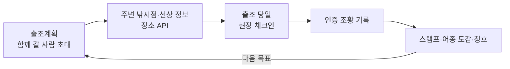

# 확장 기능 설계 — 함께 가는 출조 · 스탬프 · 주변 낚시점·선상

> 상태: 1단계(함께 가는 출조) 서버·DB·화면 완료. 2단계는 후보 조사 완료·구현 전. 3~4단계 설계안. DB 구조 변경·외부 API 도입은 각 단계마다 승인 후 진행한다.
> 세 기능은 따로가 아니라 **출조계획을 중심으로 이어진다** — 함께 계획하고(1) → 필요한 가게·배를 찾고(3) → 다녀와서 인증하면 스탬프가 쌓인다(2).

---

## 1. 함께 가는 출조계획

지금은 혼자 쓰는 계획(날짜별 장소·예비 장소·준비물·그날 해황·기록 연결)이다. 여기에 함께 가는 사람을 붙인다.

### 공유·참여
- 계획 화면 「함께 갈 사람 초대」 → **초대 링크·6자리 코드** (카카오톡 등으로 전달, 앱 안 채팅은 만들지 않음)
- 받은 사람은 로그인 후 「참여하기」 → 참여 · 미정 · 불참
- 권한: 만든 사람(수정·삭제·참여자 관리) / 참여자(보기·준비물 체크·내 정보 수정)
- 초대 링크는 만료 시간이 있고 만든 사람이 끌 수 있다

### 단체 출조 정보
| 항목 | 내용 |
|---|---|
| 집결지·출발 시각 | 「○○역 05:00 집결」, 차량별 탑승자(카풀) |
| 선상 예약 정보 | 배 이름·선장 연락처·예약 인원·1인 비용·승선 시각 (3장 장소 API 와 연결) |
| 준비물 나누기 | 공용(아이스박스·밑밥 — 담당자 지정) / 개인(구명조끼 — 각자 체크) |
| 해황 공유 | 그날 파고·풍속·물때·특보 요약을 참여자 모두 같은 화면으로 |

### 안전
- 비상 연락처: 원하는 사람만, 같은 계획 참여자에게만 보임
- 특보가 나오면 계획 화면에 경고 표시 (푸시 알림은 이후 단계)
- **실시간 위치 공유는 하지 않는다** — 「좌표는 기기 안에서만」 원칙 유지

### 다녀온 뒤
- 참여자들의 기록·인증 조황을 「이번 출조」로 묶어 보기 (예: ○○호 선상 · 우럭 23마리 · 4명)
- 비용 정산(1/n)은 선택 — 계산만, 송금 연동 없음

---

## 2. 전국 낚시 탐험 100선 · 어종 도감 (모으는 재미)

> 산 앱의 「명산 100 스탬프」처럼, 낚시인이 **다시 바다로 나갈 이유**를 만든다. 목록은 입질예보가 **공개한 기준으로 직접 검증한 장소**만 담고, 공공데이터는 후보를 찾고 금지·위험 구역을 거르는 데 쓴다.

### 명산 100 같은 제도가 낚시에도 있나? (조사 결과)

| 구분 | 제도 | 운영 주체 | 방식 |
|---|---|---|---|
| 산 | **100대 명산** 목록 | **산림청** — 목록만 선정·공표 | 목록 |
| 산 | **명산 100 챌린지** (스탬프·완주 인증) | **블랙야크(민간 브랜드)** 「블랙야크 알파인 클럽」 앱 | 산림청 목록을 바탕으로 민간이 인증·완주 관리 |
| 바다 | **등대 스탬프투어** (등대 여권) | 해양수산부 · 한국항로표지기술원 | 시즌별 등대 10여 곳, 여권 도장·QR 인증 |
| 바다 | **바다마을 스탬프투어** | 해양수산부 · 한국어촌어항공단 | 어촌체험마을 20곳, **GPS 방문 인증**, 기간 한정 |
| 바다 | 지자체 스탬프 투어 (예: 보령) | 지자체 | 지역 명소 몇 곳, 모바일 인증, 기간 한정 |
| 바다 | 국립공원 「섬과 바다」 여권 | 국립공원공단 | 섬·바다 20곳 스탬프, 완주증·기념품 (기간 종료) |
| **낚시 (기관)** | **낚시 전용 스탬프·완주 제도** | — | **찾지 못함** |
| 낚시 (정책) | 제3차 낚시진흥기본계획 — **낚시여가구역 지정** 추진 | 해양수산부 | 기사 언급만 — 이번 재조사에서 고시·데이터 **확인 안 됨** |

**민간 낚시 앱의 비슷한 기능** (앱 소개 기준 — 직접 사용해 확인하지는 않음)

| 앱 | 비슷한 기능 |
|---|---|
| 피싱태그 | 계측 사진으로 **지역별 도장깨기**·온라인 대회 |
| FINN | AI 어종 판별 **어종 도감**(미획득은 실루엣), 어종별 랭킹 배지 |
| 낚맛 | 「3짜 잡기」 같은 **챌린지**, 보상 포인트로 장비 교환 |
| 어신 | 활동 퀘스트 포인트, 조황 공유·대회 |

정리
- 「명산 100」은 **기관이 목록을 정하고(산림청), 민간 앱이 인증 챌린지를 운영(블랙야크)** 하는 구조다
- 바다 쪽 기관 스탬프 투어(등대·어촌마을·국립공원 섬)는 있지만 **낚시를 대상으로 한 기관 제도는 확인되지 않았다**
- 민간 낚시 앱에는 **어종 도감·지역 도장깨기·챌린지가 이미 있다** → 「어종 도감」 자체는 차별점이 약하다
- 「100대 명산」처럼 기관이 「가볼 만한 낚시터」를 뽑은 **공식 목록은 찾지 못했다** (해양수산부·공공데이터포털 조사). 바다낚시지수 지점은 **예보 지점**이지 명소 목록이 아니다
- 그래서 입질예보가 **기준을 공개하고 직접 검증한 「전국 낚시 탐험 100선」**을 만든다 (아래). 「낚시여가구역」은 이번 조사에서 확인되지 않아 근거로 쓰지 않는다

출처: [문화일보](https://www.munhwa.com/article/11364876) · [제3차 낚시진흥기본계획(정책브리핑)](https://www.korea.kr/news/policyNewsView.do?newsId=148944130) · [국립공원 섬과 바다 여권](https://m.korea.kr/multi/visualNewsView.do?newsId=148906721) · [낚시 앱 정리(SUPERBITE)](https://superbite.net/fishing-application-top7/) · [FINN](https://apps.apple.com/kr/app/finn-ai-%EB%82%9A%EC%8B%9C-%EB%8F%84%EA%B0%90/id6783674299) · [낚맛](https://nakmat.com/) · [어신](https://apps.apple.com/kr/app/%EC%96%B4%EC%8B%A0-%EB%B0%94%EB%8B%A4-%EB%AF%BC%EB%AC%BC-%EB%82%9A%EC%8B%9C-%EB%82%A0%EC%94%A8-%EB%AC%BC%EB%95%8C-%EC%A1%B0%EA%B3%BC-%EC%A1%B0%ED%99%A9/id1526424683) · [블랙야크 알파인 클럽 앱](https://apps.apple.com/hn/app/%EB%B8%94%EB%9E%99%EC%95%BC%ED%81%AC-%EC%95%8C%ED%8C%8C%EC%9D%B8-%ED%81%B4%EB%9F%BD-bac/id1328731534?l=en-GB) · [산림청 100대 명산 자료](https://forest.go.kr/images/data/fonDown/100_mountain_ebook.pdf) · [해양수산부 바다마을 스탬프투어 보도자료](https://www.mof.go.kr/doc/ko/selectDoc.do?docSeq=58049&bbsSeq=10&menuSeq=971) · [등대 스탬프투어 기사](https://news.bbsi.co.kr/news/articleView.html?idxno=3120066) · [대한민국 정책브리핑](https://www.korea.kr/briefing/pressReleaseView.do?newsId=156572585) · [보령 스탬프 투어 기사](https://mnlnews.net/news/view.php?bIdx=50269)

### 방향 (수정)
- **장기 목표: 입질예보 자체 선정 「전국 낚시 탐험 100선」.** 기관이 뽑은 목록이 아니라 **입질예보가 기준을 정해 직접 검증해 고른 목록**이다. 「공식 명소」「기관 선정」 같은 표현은 쓰지 않는다
- 100곳을 채우려고 장소를 임의로 넣지 않는다. **6가지 기준을 모두 확인한 곳만** 공개하고, 처음에는 20~30곳에서 시작한다
- **공식 예보 지점(국립해양조사원 바다낚시지수 49곳)은 챌린지 대상이 아니다.** 해황 데이터 연계와 후보 지역 검토에만 쓴다. 예보 지점이라는 이유만으로 낚시 명소로 분류하지 않는다
- 바다별 탐험 코스: **동해 · 서해 · 남해 · 제주**
- **두 종류의 장소를 따로 관리한다**
  - 탐험형 낚시 장소: 항구·방파제·갯바위·해변 → 「탐험 100선」 대상
  - 유료 낚시 시설: 좌대·수상 방갈로·해상 낚시공원 → 별도 목록. 실제 낚시 위치·현재 운영 여부·이용 조건을 따로 확인하고, 탐험 100선에 자동으로 넣지 않는다

### 장소 검증 기준 (6가지 — 모두 확인되어야 「검증 완료」)
| # | 기준 | 확인할 것 |
|---|---|---|
| 1 | 실제 낚시 위치 좌표 | 사업장 주소·항구 대표점이 아니라 낚시하는 자리 (좌표 A등급) |
| 2 | 접근 가능 여부 | 도보·차량 접근, 연륙교 여부, 출입 제한 |
| 3 | 낚시 가능 여부·제한 규정 | 지자체 낚시통제구역 고시, 해경 출입통제구역, 항만 규정, 유료 시설이면 신고·운영 상태 |
| 4 | 장소 유형 | 방파제·갯바위·선착장·해변 / 유료 시설 |
| 5 | 탐험형 챌린지 선정 가치 | 바다별 대표성, 대상 어종, 안전 (연안위험구역이면 안전 안내 필요) |
| 6 | 공식 근거 | 근거 URL · 확인 날짜 · 검증 이력 |

- 공식 자료에 장소가 나와도 **낚시 허용 여부가 확인되지 않으면 검증 완료가 아니다**
- 검증 완료 장소도 규정 변경·운영 중단이 있을 수 있어 **재검증 주기**(예: 6개월, 통제구역 고시 갱신 시 즉시)를 둔다

### 인증 (방문과 조황을 나눈다)
| 인증 | 방법 | 쌓이는 것 |
|---|---|---|
| **방문 인증** | 현장 체크인 — 누를 때만 GPS 확인, 서버에는 「성공·장소·시각」만 (좌표 저장 안 함) | 탐험 스탬프 |
| **조황 인증** | 기존 낚시일지 사진 인증(관리자 검토) | 조황 배지·어종 도감 |

- **같은 사람 · 같은 장소 · 같은 인증 종류는 한 번만** 달성으로 친다 (다시 가도 기록은 남고 스탬프는 늘지 않음)
- 검증 완료가 아닌 장소(후보·보류·제외)에서는 체크인 버튼이 나오지 않는다

### 관리 데이터 (설계안 — 구현은 승인 후)
| 표 | 내용 |
|---|---|
| `challenge_spot` | 장소(기존 `place` 연결 또는 새 좌표) · 유형(탐험형/유료 시설) · 바다(동·서·남·제주) · **상태(후보 → 검증 중 → 검증 완료 → 보류·제외)** · 선정 근거 · 다음 재검증 날짜 |
| `challenge_spot_check` | 기준 1~6 항목별 결과 · 근거 URL · 확인 날짜 · 확인한 사람 — 고치지 않고 **이력으로 쌓음** (현재 상태 = 최신 기록) |
| `challenge_achievement` | 사용자 · 장소 · 종류(방문/조황) · 근거(체크인 시각 또는 인증된 일지) — **(사용자, 장소, 종류) 유일** |

---

### 후보 조사 결과

> 수치는 **이번에 내려받아 직접 센 값**과 **페이지 표기만 본 값**을 구분한다. 거리·겹침 분석은 **현재 보유한 데이터에 한정된 결과**다.

#### 현재 운영 DB (219곳, 직접 셈)
| 구분 | 수 | 좌표 | 판단 |
|---|---|---|---|
| 해상 유료 낚시터 (전국낚시터정보표준데이터 바다 유형) | 162 | C 155 · D 7 (사업장 주소·대략 위치) | 유료 시설 목록 후보 — 위치·운영 확인 필요 |
| 공식 예보 지점 (갯바위권 34 · 선상 15) | 49 | B (기관 대표 지점) | 챌린지 대상 아님 — 해황 연계용 |
| 항구·해변 (OpenStreetMap 좌표 수동 등록) | 8 | C | 후보 — 낚시 허용 확인 필요 |

- **기존 운영 DB 에서 6가지 검증 기준을 모두 충족한다고 확인된 장소는 0곳이다.** (A등급 좌표 0곳, 인증 조황 0건)
- 공식 예보 지점 49곳 중 1km 안에 현재 DB 의 연안 낚시터가 있는 곳은 1곳 (현재 보유 데이터 기준)

#### 공식 자료 정리 (모두 공공데이터포털에서 로그인 없이 내려받아 직접 셈)

> **원칙: 낚시금지·통제 자료에 들어 있지 않다는 이유만으로 「낚시 가능」으로 판정하지 않는다.** 금지 자료는 빼는 데만 쓰고, 낚시 가능은 6가지 기준으로 따로 확인한다.

| 자료 | 제공 · 기준일 | 장소 수 | 좌표 | 적용 범위 | 분류 |
|---|---|---|---|---|---|
| [해양수산부 갯바위낚시포인트](https://www.data.go.kr/data/15148580/fileData.do) | 해수부 · 2022-12-31 | 1,076 | 있음 (EPSG:5179 → 변환, 공식 위도 값과 일치 확인) | 전국 연안·섬 | **후보** (낚시 허용 명시 없음 — 「행정·정책 기초자료」) |
| [해양수산부 선상낚시포인트](https://www.data.go.kr/data/15148435/fileData.do) | 해수부 · 2023-12-31 | 329 | 있음 | 전국 해상 | 참고 (방문 인증 부적합) |
| [해양수산부 바다낚시터](https://www.data.go.kr/data/15148583/fileData.do) | 해수부 · 2016-12-04 | 219 | 있음 | 전국 유료·체험 낚시터 | **유료 시설 후보** (오래된 자료 — 운영 여부 확인 필요) |
| [해양수산부 어항 통합 목록](https://www.data.go.kr/data/15147455/fileData.do) | 해수부 · 2021-11-23 | 2,299 | 정밀 423 · 약 1km 615 · 없음 1,261 | 전국 어항 (등급 구분 없음) | **후보 데이터** — 낚시 관련 항목 없음. 낚시 가능 근거 아님 |
| [해경 연안 출입통제구역](https://www.data.go.kr/data/15110667/fileData.do) | 해양경찰청 · 2023-05-01 | 43개 구역 (약 22곳) | 폴리곤 (WGS84) | 일부 해역만 (경북·강원·경남 없음) | **제외** (법적 출입 금지) · **⚠ 2023년 자료 — 이후 지정 별도 확인 필요** |
| [해경 연안위험구역](https://www.data.go.kr/data/15110661/fileData.do) | 해양경찰청 · 2025-12-09 | 820개 구역 | 폴리곤 (WGS84) | 해경서 20곳 전체 | **주의** — 위험 표시이지 낚시금지구역이 아님. 제외하지 않고 안전 안내 |
| 지자체 낚시통제구역 (시군별 49개 파일) | 각 시군 · 2025~2026 | 바다 쪽 8개 시군 약 25곳 (부산 수영·기장, 강릉, 속초, 경남 고성, 사천, 거제, 당진) | **없음** (글자 설명·지번) | 공개한 시군만 | **제외** (수동 대조) — 공개 안 한 해안 시군은 확인 필요 |
| [국립해양조사원 낚시금지구역](https://www.data.go.kr/data/15130115/fileData.do) | 2025-08-13 | 25개 구역 | 폴리곤 (UTM-K 계열) | 해도 표시 구역 | 제외 후보 — 이름 대부분 비어 있어 확인 필요 |

- **전국 낚시통제구역 통합 목록은 없다.** 공공데이터에 고시가 없는 해안 시군(포항·여수·통영·태안·제주 등)은 각 시군 고시 게시판을 따로 확인해야 한다 — 확인 필요
- 해경 출입통제구역 이후 지정 보도 (반영 안 됨): 울릉 테트라포드 4곳(2026-08), 양양 하조대 갯바위(2026-07), 동해·삼척·울릉 12곳 추진 — 확인 필요
- 행정안전부 낚시터정보(표기 1,148행)는 이미 가진 「전국낚시터정보표준데이터」(1,151행)와 같은 계열이라 다시 받지 않았다

#### 지자체·관광 공식 안내 — 소개 방식 구분 (허가 근거 아님)
| 구분 | 출처 | 장소 | 원문 표현 |
|---|---|---|---|
| **낚시 장소로 소개** | [부안군 「바다 낚시 포인트」](https://www.buan.go.kr/tour/index.buan?menuCd=DOM_000000209005004000) | 격포항 남방파제 낚시잔교 (+ 위도·식도 등 섬) | 낚시 포인트 안내 페이지 — ⚠ 같은 항에 해경 출입통제구역 |
| 낚시 장소로 소개 | [보령시 「바다낚시」](https://www.brcn.go.kr/tour/sub02_04_02.do) | 무창포 방파제, 오천·천북 갯바위 | 「방파제에서 가장자리 낚시를 할 수 있으나 대개는 배낚시」 |
| 낚시 장소로 소개 | [비짓부산](https://www.visitbusan.net/index.do?menuCd=DOM_000000202002001000&uc_seq=790) | 암남공원 방파제, 영도 신방파제 | 방파제 낚시 명소 |
| 낚시 장소로 소개 | [포항시 관광](https://www.pohang.go.kr/phtour/wmap/tourInformation/view.do?menu_idx=47&tour_info_idx=764) | 석병1리방파제 | 「바다낚시 명소」 |
| 관광지 소개 + 낚시 언급 | [강원 고성군](https://www.gwgs.go.kr/prog/tursmCn/tour/sub02_02/view.do?cntno=76) | 봉포해변 | 「방파제에서는 연중 바다낚시를 할 수 있다」 |
| 관광지 소개 + 낚시 언급 | [강릉시](https://www.gn.go.kr/tour/prog/lod/Sights/S0107/sub02_02_08/view.do?cid=919) | 강릉항, 안인항 | 「낚시하기 좋은 장소」「바다 낚시로 매우 유명」 |
| 관광지 소개 + 낚시 언급 | [충남관광](https://tour.chungnam.go.kr/prog/trsrcn/kor/sub02_01_02/view.do?trsrcnNo=1260) | 서산 A지구 방조제 | 「낚시를 즐길 수 있는 장소로도 알려져」 (블로그 글 혼재) |
| 체험기·권역만 | 태안군 여행이야기, 완도군 | 마도 방파제·안흥항 / 권역 단위 | 체험기 형식 또는 특정 장소 없음 — 근거로 약함 |
| 검색 결과만 | 비짓제주 | 삼양방파제, 영락리방파제, 현사포구, 월령포구 | 페이지 미확인 — 확인 필요 (삼양방파제는 추락 사고 언급) |
| **유료 낚시 시설 안내** | 태안(해상낚시공원 3) · 여수(돌산) · 장흥(정남진) · 하동(해와달) · 거제(17) · 당진(19) 관광 누리집 | 유료 시설 | 시설 안내 — 운영 여부·이용 조건 확인 필요 |

#### 갯바위낚시포인트 1,076곳 분석 (직접 계산)
| 바다 | 전체 | 이름에 항·방파제·선창·해수욕장 등 (연안 접근형 표시) | 지역명이 「~도」인 섬 (추정) |
|---|---|---|---|
| 동해 | 102 | 50 | 7 |
| 서해 | 373 | 42 | 338 |
| 남해 | 517 | 55 | 278 |
| 제주 | 84 | 7 | 65 |

- 섬 여부는 지역명으로 나눈 **추정값**이다 — 연륙교(안면도·영흥도·고군산·원산도·진도·거제 등) 여부는 확인 필요
- 해경 출입통제구역 안(200m 이내): **1곳** — 서귀포 「황우리해안 갯바위」(해경 「황우지해안」 출입통제) → **공식 포인트 자료에 있어도 제외**해야 하는 사례
- 연안위험구역 안(100m 이내): 79곳 → 후보는 될 수 있으나 안전 안내 필수
- 기존 낚시터 219곳과의 겹침은 아래 「기존 219곳과 새 후보의 중복」 참고

#### 공식 자료끼리 충돌하는 사례
- **부안 격포항**: 부안군 관광 누리집은 「격포항 남방파제 낚시잔교」를 바다 낚시 포인트로 소개하지만, 해경은 「격포항 방파제 테트라포드 일원」을 **출입통제구역**으로 지정했다 → 잔교와 통제 구간의 경계를 확인하기 전에는 보류
- **부산 기장 대변항**: 해수부 포인트 「대변항 북측 갯바위」가 있지만 기장군은 「대변항 월드컵방파제 테트라포드」를 낚시통제구역으로 지정 → 같은 항 안의 다른 구간인지 확인 필요

#### 기존 219곳과 새 후보의 중복 (현재 보유 데이터 기준)
| 새 자료 | 기존 219곳과 겹침 | 방법 |
|---|---|---|
| 갯바위 포인트 1,076 | 74곳이 기존 낚시터 1km 이내 (예보 지점 41 · 유료 31 · 항구·해변 2) → **새 후보 1,002곳** | 좌표 거리 |
| 해수부 바다낚시터 219 | 39곳이 기존 유료 낚시터 1km 이내 | 좌표 거리 |
| 어항 2,299 (정밀 좌표 423) | 36곳이 기존 낚시터 1km 이내 (유료 20 · 예보 지점 10 · 항구 5 · 해변 1). 이름 일치 28개 — 「대진항」처럼 같은 이름이 여러 지역에 있어 **이름만으로는 확정 불가** | 좌표 거리 + 이름 |
| 갯바위 포인트 ↔ 어항 | 갯바위 포인트 172곳이 정밀 좌표 어항 1km 이내 | 좌표 거리 |

#### 우선 후보 24곳 (모두 **후보 · 확인 필요** — 낚시 가능으로 판단하지 않음)
선정 기준: ① 해양수산부 갯바위낚시포인트에 대상어·낚시 방법이 있는 곳 ② 이름상 항구·방파제·해변 등 육지에서 접근할 수 있어 보이는 곳 (접근은 확인 필요) ③ 해경 출입통제구역 밖 ④ 바다별로 고르게 ⑤ 지자체 관광 안내에도 이름이 나오거나 공식 예보 지점이 가까워 해황 연계가 되면 우선

| 바다 | 장소 (해수부 포인트명) | 시군 | 선정 이유 | 확인할 것 |
|---|---|---|---|---|
| 동해 | 석병방파제 갯바위 | 포항 | 해수부 포인트 + 포항시 관광 「석병1리방파제 바다낚시 명소」 (출처 2곳) | 방파제 출입·통제 고시 |
| 동해 | 봉포해변 갯바위 | 고성(강원) | 해수부 포인트 + 고성군 「방파제에서 연중 바다낚시」 (출처 2곳) | **연안위험구역** — 안전 |
| 동해 | 남애항 남측 갯바위 | 양양 | 해수부 포인트, 예보 지점 「남애항」 0.3km (해황 연계) | 접근·통제 |
| 동해 | 대진항 내항 | 삼척 | 해수부 포인트, 예보 지점 「대진항」 0.2km | 항내 낚시 허용 |
| 동해 | 아야진 방파제 갯바위 | 고성(강원) | 해수부 포인트, 예보 지점 「아야진항」 0.3km | **연안위험구역** — 안전 |
| 동해 | 감포항 송대말 등대 앞 갯바위 | 경주 | 해수부 포인트 | 접근·통제 |
| 동해 | 봉수항 남측 갯바위 | 울진 | 해수부 포인트, 예보 지점 「울진 후정」 2km | 접근·통제 |
| 동해 | 제전항 남측 갯바위 | 울산 북구 | 해수부 포인트 | 접근·통제 |
| 서해 | 샛별 해수욕장 남측 갯바위 | 태안 (안면도) | 해수부 포인트 | 연륙·접근 |
| 서해 | 방포해변 북측 갯바위 | 태안 (안면도) | 해수부 포인트, 예보 지점 「방포항」 0.8km | 연륙·접근 |
| 서해 | 영흥도 양로봉 갯바위(신노루) | 인천 옹진 | 해수부 포인트, 예보 지점 「영흥도」 0.04km | 접근·통제 |
| 서해 | 무녀도 구마을 백사장 부근 | 군산 (고군산) | 해수부 포인트, 예보 지점 「신시도」 1.4km | 새만금 통제구역과 거리 |
| 서해 | 원산도 용뿌리 갯바위 | 보령 | 해수부 포인트 | 연륙(해저터널)·접근 |
| 서해 | 격포항 남방파제 낚시잔교 | 부안 | 부안군 관광 「바다 낚시 포인트」 | **해경 출입통제구역과 같은 항 — 보류 후보** |
| 남해 | 온정방파제 동측 남사암 | 부산 기장 | 해수부 포인트 | 접근·통제 |
| 남해 | 대변항 북측 갯바위 | 부산 기장 | 해수부 포인트 | **기장군 낚시통제구역(같은 항)과 경계** |
| 남해 | 구조라해수욕장 호안로 갯바위 | 거제 | 해수부 포인트 | 거제 통제구역(지세포)과 다른 곳인지 |
| 남해 | 예구마을 제방 끝 갯바위 | 거제 | 해수부 포인트 | 접근·통제 |
| 남해 | 국동항 인근 | 여수 | 해수부 포인트 | 항내 규정 |
| 남해 | 접도리 선창 | 진도 | 해수부 포인트 | 연륙·접근 |
| 제주 | 신양포구 갯바위 | 서귀포 | 해수부 포인트 | 접근·통제 |
| 제주 | 영락리 큰산물 낚시터 | 서귀포 | 해수부 포인트 + 비짓제주 「영락리방파제」 (같은 곳인지 확인) | 같은 장소 여부 |
| 제주 | 쇠소깍 해수욕장 우측 갯바위 | 서귀포 | 해수부 포인트 | 관광지 — 낚시 허용 |
| 제주 | 표선해비치해수욕장 좌측 갯바위 | 서귀포 | 해수부 포인트 | 해수욕장 — 낚시 허용 |

- 서해·제주는 육지에서 접근하는 항구·방파제형 포인트가 적어(해수부 자료 기준) 연륙 섬 포인트로 채웠다 — 연륙 여부는 확인 필요
- 유료 시설 목록 후보(탐험 100선과 별도): 당사해양낚시공원(울산) · 나곡바다낚시공원(울진) · 정남진해양낚시공원(장흥) · 돌산해양낚시공원(여수) · 태안 해상낚시공원 3곳 · 하동 해와달 해양낚시공원 — 운영 여부·이용 조건 확인 필요

#### 최종: 검증 가능한 장소 수와 추가 확인 항목
| 단계 | 수 | 의미 |
|---|---|---|
| 검증 완료 (6가지 기준 모두 확인) | **0** | 기존 운영 DB·새 자료 어디에서도 아직 없음 |
| 검증 착수 가능 (우선 후보) | **24** | 위치·대상어 공식 자료가 있고 출입통제구역 밖 — 나머지 기준을 확인할 수 있는 곳 |
| 후보 (탐험형) | 갯바위 1,002 + 기존 항구·해변 8 (+ 어항 2,299는 위치 참고용) | 기준 대부분 미확인 |
| 후보 (유료 시설) | 기존 162 + 해수부 바다낚시터 중 새것 180 + 낚시공원 | 운영 여부·이용 조건 미확인 |
| 제외 | 출입통제구역 안 1 (황우리해안 갯바위) + 지자체 통제구역 대조 결과 | — |

추가 확인이 필요한 항목
1. **낚시 허용**: 지자체 낚시통제구역 고시가 공공데이터에 없는 해안 시군 — 시군 고시 게시판 확인
2. **최신 통제**: 해경 출입통제구역 2023년 이후 지정 — 각 해양경찰서 공고 확인
3. **항만 규정**: 항내·방파제 낚시 제한(지방해양수산청) — 통합 자료 없음, 항구별 확인
4. **접근**: 연륙교 여부, 도보·차량 접근, 사유지·군사시설 여부
5. **실제 낚시 자리 좌표**: 해수부 포인트 좌표가 실제 서는 자리인지 (현장 사진·지도)
6. **충돌 해소**: 격포항(부안군 안내 vs 해경 통제), 대변항(해수부 포인트 vs 기장군 통제구역)
7. **유료 시설**: 현재 운영 여부·이용 조건 (2016·2018년 자료 다수)

#### 다음 단계 (승인 후)
1. 우선 후보 24곳을 장소마다 6가지 기준으로 확인 (지자체 고시·해경 공고·현장 사진·지도) → 검증 완료만 공개
2. 지자체 낚시통제구역 글자 설명 약 25곳을 좌표로 옮겨 자동 대조에 추가
3. 관리 데이터(위 3개 표) 구현 · 방문 체크인 · 탐험북 화면
4. 어종 도감은 조황 인증에 붙는 보조 기능으로 유지

출처 (조사): [갯바위낚시포인트](https://www.data.go.kr/data/15148580/fileData.do) · [선상낚시포인트](https://www.data.go.kr/data/15148435/fileData.do) · [바다낚시터](https://www.data.go.kr/data/15148583/fileData.do) · [어항](https://www.data.go.kr/data/15147455/fileData.do) · [해경 출입통제구역](https://www.data.go.kr/data/15110667/fileData.do) · [해경 연안위험구역](https://www.data.go.kr/data/15110661/fileData.do) · [낚시금지구역(국립해양조사원)](https://www.data.go.kr/data/15130115/fileData.do) · [기장군 낚시통제구역](https://www.data.go.kr/data/15119776/fileData.do) · [거제시 낚시통제구역](https://www.data.go.kr/data/15160350/fileData.do) · [부안군 바다 낚시 포인트](https://www.buan.go.kr/tour/index.buan?menuCd=DOM_000000209005004000) · [포항 석병1리방파제](https://www.pohang.go.kr/phtour/wmap/tourInformation/view.do?menu_idx=47&tour_info_idx=764) · [고성 봉포해변](https://www.gwgs.go.kr/prog/tursmCn/tour/sub02_02/view.do?cntno=76)

---

## 3. 주변 낚시점 · 선상(배) 정보 — 외부 장소 API

> 낚시터 상세에서 「근처 낚시점 · 선상낚시」를 보여주고, 출조계획의 선상 예약 정보 칸(1장)에 바로 넣을 수 있게 한다.

### 새로 발급받아야 하는 API (공식 문서 확인 결과)

| API | 발급 | 무료 사용량 · 비용 | 좌표 + 반경 검색 | 결과 저장 | 표시 의무 |
|---|---|---|---|---|---|
| **카카오 로컬 API** (키워드 검색) | Kakao Developers 앱 생성 → 카카오맵 「사용 설정」→ REST API 키 (심사 없음) | 키워드 검색 하루 10만 건 무료(계정의 첫 활성화 앱만), 초과 건당 2원 | **지원** — 반경 최대 20km, 한 번에 15건, 거리순 | **불가** — 실시간 호출만 (장소 ID·카카오맵 링크만 저장 가능하다는 답변 있음) | 명시 조항 미확인 |
| 네이버 지역 검색 | 개발자센터 신규 신청 종료 → 네이버 클라우드 API HUB 에서 발급 | 하루 2만 5천 건, 현재 한시적 무료 | **미지원** (검색어만, 한 번에 최대 5건, 전화번호 없음) | 원칙상 금지 (임시 캐시만) | 「네이버 검색결과」 표시·원본 링크 필수 |
| Google Places (New) | GCP 프로젝트 + **결제 계정 필수** | 월 무료 5,000건(Pro), 초과 1,000건당 약 $32 | 지원 | place_id 만 저장 가능 | **구글 지도가 아닌 지도와 함께 쓰면 안 됨** (앱은 iOS 기본 지도) + 구글 로고 |
| **해양수산부 낚시 어선업 신고정보** (공공데이터포털 OpenAPI) | 공공데이터포털 활용신청 (기존 계정에 추가) | 무료, 이용 제한 없음 | 좌표 없음 | **가능** | 없음 |
| 지자체 낚시어선 현황 (경기도 OpenAPI 등) | 공공데이터포털 활용신청 | 무료 | 좌표 없음 (주소·출입항) | 가능 | 없음 |

- 낚시점 전용 공공데이터, 「선박명 + 전화번호 + 좌표」를 한 번에 주는 낚시어선 데이터는 찾지 못했다
- 카카오 로컬에는 낚시점 카테고리 코드가 없어 키워드(「낚시」「선상낚시」)로 검색한다
- 구글은 지도 조건(구글 지도와 함께만) 때문에 지금 앱 구조와 맞지 않는다

### 결론 (제안)
1. **선상(배)**: 해양수산부 낚시 어선업 신고정보(무료·저장 가능)로 **신고된 배인지·정원·선적항**을 보여준다. 전화번호·위치는 없으므로 출조계획에 직접 입력
2. **주변 낚시점·선상 업체 위치·전화**: **카카오 로컬 API** — 낚시터 상세를 열 때 서버가 실시간 조회, DB 에 저장하지 않음, 카카오맵 링크로 연결
3. 발급 필요: **카카오 REST API 키 1개** + 공공데이터포털에서 **낚시 어선업 신고정보 활용신청** (기존 `DATA_GO_KR_API_KEY` 계정에 추가)

### 원칙
- **약관이 저장을 막으면 저장하지 않는다** — 카카오 결과는 낚시터 상세를 열 때 서버가 그때 조회해서 보여주고 출처(카카오맵 링크)를 표시한다 (VWorld 좌표를 저장하지 않은 것과 같은 방식)
- 광고·제휴 업체는 「광고」로 표시하고 일반 검색 결과와 섞지 않는다
- 예약·결제는 앱이 직접 하지 않고 업체 전화·예약 페이지로 이동한다
- 앱이 업체의 품질을 평가·추천하지 않는다 (커뮤니티 후기는 사용자 글로만)
- 인증키는 서버 비밀값에만 — 앱 번들에 넣지 않는다 (지금 공공 API 와 같은 방식)

### 화면
- 낚시터 상세 → 「근처 낚시점 · 선상낚시」 목록 (거리·전화·지도 열기, 출처 표시)
- 출조계획 → 선상 예약 정보 칸에서 「근처 선상낚시 찾기」로 이름·연락처를 바로 채우기

---

## 4. 데이터 구조

| 표 | 내용 | 기능 | 상태 |
|---|---|---|---|
| `trip_member` | 계획 · 사용자 · 상태(참여·미정·불참) — 만든 사람은 기존 `trip_plan.user_id` | 1 | **구현·운영 DB 적용 완료 (Alembic 0002)** |
| `trip_invite` | 6자리 코드 · 만료(7일) · 끄기 | 1 | **구현·적용 완료** |
| `trip_checklist_item.assignee_user_id` | 공용 준비물 담당자 | 1 | **구현·적용 완료** |
| `trip_plan` (열 추가) | 집결지 · 출발 시각 · 선상 예약 정보(배 이름·어선 신고번호·연락처·인원·비용) | 1·3 | 다음 단계 |
| `species` (행 추가) | 돌돔·벵에돔·열기·문어·갈치·붕장어 6종 — 어종 도감·기록 정확도 | 2 | 데이터 추가 (승인 필요) |
| `challenge_spot` · `challenge_spot_check` · `challenge_achievement` | 탐험 100선 장소 · 6가지 기준 검증 이력 · 방문/조황 달성 (2장 「관리 데이터」) | 2 | 설계안 (승인 필요) |
| `fishing_boat` (선택) | 해양수산부 낚시 어선업 신고정보 사본(어선명·신고번호·선적항·최대 승객 수·유효기간) — 공공데이터라 저장 가능 | 3 | 다음 단계 |
| (저장 안 함) | 카카오 로컬 검색 결과 — 실시간 조회만 | 3 | — |

기존 구조에서 바뀐 점 (1단계 구현): 출조계획 접근 검사를 「만든 사람만」에서 「만든 사람 또는 참여자(보기·준비물 체크·자기 담당·계획 장소에 기록)」로 넓혔다. 계획·장소 수정과 삭제는 만든 사람만.

## 5. 단계

| 단계 | 범위 | 필요한 결정 |
|---|---|---|
| **1단계** | 초대·참여·참여자 목록, 함께 보는 해황, 공용/개인 준비물·담당자 | DB 구조 추가 승인 |
| **2단계** | 「전국 낚시 탐험 100선」 — 후보 검증(20~30곳부터) · 방문 체크인 · 조황 인증 연결 · 탐험북 화면 | 우선 후보 검증 결과 승인, 체크인 거리 기준 |
| **3단계** | 근처 낚시점·선상 정보(장소 API), 선상 예약 정보 칸 연결, 집결지·카풀 | 사용할 장소 API·약관·비용 확인 후 승인 |
| **4단계** | 다녀온 뒤 기록 묶음, 계절·물때 배지, 정산, 푸시 알림 | 알림 도입 여부 |

## 6. 지켜야 할 것

- 실제 조황·입질을 예측하거나 업체를 평가하지 않는다
- 위치는 누를 때만, 좌표는 기기 안에서만 (체크인 결과만 서버로)
- 좌표가 의심되는 낚시터는 체크인·스탬프·추천에서 제외 (기존 정책)
- 외부 API 의 약관(저장·표기·호출량)을 먼저 확인하고, 막으면 저장하지 않는다

관련: [기획 의도](기획의도.md) · [차별성](차별성.md) · [외부 API](../03_데이터/외부_API.md) · [화면 설계](../05_UX/화면_설계.md)
