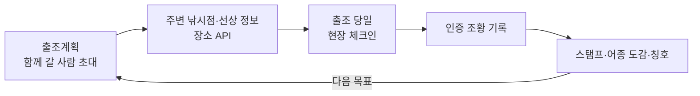

# 확장 기능 설계 — 함께 가는 출조 · 스탬프 · 주변 낚시점·선상

> 상태: 1단계(함께 가는 출조) 서버 구현 완료·DB 적용 전, 2~4단계 설계안. DB 구조 변경·외부 API 도입은 각 단계마다 승인 후 진행한다.
> 세 기능은 따로가 아니라 **출조계획을 중심으로 이어진다** — 함께 계획하고(1) → 필요한 가게·배를 찾고(3) → 다녀와서 인증하면 스탬프가 쌓인다(2).

---

## 1. 함께 가는 출조계획

지금은 혼자 쓰는 계획(날짜별 장소·예비 장소·준비물·그날 해황·기록 연결)이다. 여기에 함께 가는 사람을 붙인다.

### 공유·참여
- 계획 화면 「함께 갈 사람 초대」 → **초대 링크·6자리 코드** (카카오톡 등으로 전달, 앱 안 채팅은 만들지 않음)
- 받은 사람은 로그인 후 「참여하기」 → 참여 · 미정 · 불참
- 권한: 만든 사람(수정·삭제·참여자 관리) / 참여자(보기·준비물 체크·내 정보 수정)
- 초대 링크는 만료 시간이 있고 만든 사람이 끌 수 있다

### 단체 출조 정보
| 항목 | 내용 |
|---|---|
| 집결지·출발 시각 | 「○○역 05:00 집결」, 차량별 탑승자(카풀) |
| 선상 예약 정보 | 배 이름·선장 연락처·예약 인원·1인 비용·승선 시각 (3장 장소 API 와 연결) |
| 준비물 나누기 | 공용(아이스박스·밑밥 — 담당자 지정) / 개인(구명조끼 — 각자 체크) |
| 해황 공유 | 그날 파고·풍속·물때·특보 요약을 참여자 모두 같은 화면으로 |

### 안전
- 비상 연락처: 원하는 사람만, 같은 계획 참여자에게만 보임
- 특보가 나오면 계획 화면에 경고 표시 (푸시 알림은 이후 단계)
- **실시간 위치 공유는 하지 않는다** — 「좌표는 기기 안에서만」 원칙 유지

### 다녀온 뒤
- 참여자들의 기록·인증 조황을 「이번 출조」로 묶어 보기 (예: ○○호 선상 · 우럭 23마리 · 4명)
- 비용 정산(1/n)은 선택 — 계산만, 송금 연동 없음

---

## 2. 스탬프 · 어종 도감 (모으는 재미)

> 산 앱의 「명산 100 스탬프」처럼, 낚시인이 **다시 바다로 나갈 이유**를 만든다. 지어낸 명소 목록이 아니라 앱이 이미 가진 **공식 데이터 기준**으로 모은다.

### 모으는 것
| 컬렉션 | 기준 | 비고 |
|---|---|---|
| **공식 포인트 스탬프** | 국립해양조사원 바다낚시지수 지점 49곳 (갯바위 34 · 선상 15) | 기관이 지정한 지점이라 「100대 명산」처럼 공신력 있는 목록이 된다 |
| **바다별 정복** | 서해 · 남해 · 동해 · 제주 각 바다의 지점·낚시터 방문 | 「서해 10곳」 같은 단계 배지 |
| **어종 도감** | 우럭·감성돔·농어 등 어종 일러스트 15종 (이미 있는 그림) | **인증 조황**으로만 칸이 채워짐, 최대어 기록 표시 |
| **계절·물때 배지** | 예: 「사리 물때 3회 출조」「겨울 볼락」 | 기록의 날짜·물때(공식 발표값)로 판정 |

### 인증 방법 (가짜 스탬프 방지)
1. **현장 체크인** — 낚시터 상세의 「여기서 체크인」을 누르면 그때만 GPS 를 확인해, 낚시터에서 일정 거리(예: 500m — 좌표 품질 등급별로 다르게) 안이면 스탬프
   - 서버로는 「체크인 성공·낚시터 ID·시각」만 보낸다. **좌표 자체는 보내거나 저장하지 않는다**
   - 좌표가 의심되는 낚시터(D 등급·추천 보류)는 체크인 스탬프 대상에서 제외 — 위치가 틀린 곳에서 인증을 요구하지 않음
2. **어종 도감은 인증 조황만** — 지금 있는 관리자 사진 검토 흐름 그대로 (사진 촬영 시각·장소와 기록 비교)
3. 스탬프는 포인트·칭호(이미 있음)와 연결 — 새 점수 체계를 만들지 않고 기존 「인증 완료 기록에만 포인트」 원칙을 따른다

### 화면
- 내정보 → 「스탬프북」: 지도 위 49개 지점(찍은 곳 색칠), 바다별 진행률, 어종 도감 15칸(빈 칸은 그림자)
- 출조계획에서 「아직 안 가 본 공식 포인트」 추천 → 1장과 연결

---

## 3. 주변 낚시점 · 선상(배) 정보 — 외부 장소 API

> 낚시터 상세에서 「근처 낚시점 · 선상낚시」를 보여주고, 출조계획의 선상 예약 정보 칸(1장)에 바로 넣을 수 있게 한다.

### 새로 발급받아야 하는 API (공식 문서 확인 결과)

| API | 발급 | 무료 사용량 · 비용 | 좌표 + 반경 검색 | 결과 저장 | 표시 의무 |
|---|---|---|---|---|---|
| **카카오 로컬 API** (키워드 검색) | Kakao Developers 앱 생성 → 카카오맵 「사용 설정」→ REST API 키 (심사 없음) | 키워드 검색 하루 10만 건 무료(계정의 첫 활성화 앱만), 초과 건당 2원 | **지원** — 반경 최대 20km, 한 번에 15건, 거리순 | **불가** — 실시간 호출만 (장소 ID·카카오맵 링크만 저장 가능하다는 답변 있음) | 명시 조항 미확인 |
| 네이버 지역 검색 | 개발자센터 신규 신청 종료 → 네이버 클라우드 API HUB 에서 발급 | 하루 2만 5천 건, 현재 한시적 무료 | **미지원** (검색어만, 한 번에 최대 5건, 전화번호 없음) | 원칙상 금지 (임시 캐시만) | 「네이버 검색결과」 표시·원본 링크 필수 |
| Google Places (New) | GCP 프로젝트 + **결제 계정 필수** | 월 무료 5,000건(Pro), 초과 1,000건당 약 $32 | 지원 | place_id 만 저장 가능 | **구글 지도가 아닌 지도와 함께 쓰면 안 됨** (앱은 iOS 기본 지도) + 구글 로고 |
| **해양수산부 낚시 어선업 신고정보** (공공데이터포털 OpenAPI) | 공공데이터포털 활용신청 (기존 계정에 추가) | 무료, 이용 제한 없음 | 좌표 없음 | **가능** | 없음 |
| 지자체 낚시어선 현황 (경기도 OpenAPI 등) | 공공데이터포털 활용신청 | 무료 | 좌표 없음 (주소·출입항) | 가능 | 없음 |

- 낚시점 전용 공공데이터, 「선박명 + 전화번호 + 좌표」를 한 번에 주는 낚시어선 데이터는 찾지 못했다
- 카카오 로컬에는 낚시점 카테고리 코드가 없어 키워드(「낚시」「선상낚시」)로 검색한다
- 구글은 지도 조건(구글 지도와 함께만) 때문에 지금 앱 구조와 맞지 않는다

### 결론 (제안)
1. **선상(배)**: 해양수산부 낚시 어선업 신고정보(무료·저장 가능)로 **신고된 배인지·정원·선적항**을 보여준다. 전화번호·위치는 없으므로 출조계획에 직접 입력
2. **주변 낚시점·선상 업체 위치·전화**: **카카오 로컬 API** — 낚시터 상세를 열 때 서버가 실시간 조회, DB 에 저장하지 않음, 카카오맵 링크로 연결
3. 발급 필요: **카카오 REST API 키 1개** + 공공데이터포털에서 **낚시 어선업 신고정보 활용신청** (기존 `DATA_GO_KR_API_KEY` 계정에 추가)

### 원칙
- **약관이 저장을 막으면 저장하지 않는다** — 카카오 결과는 낚시터 상세를 열 때 서버가 그때 조회해서 보여주고 출처(카카오맵 링크)를 표시한다 (VWorld 좌표를 저장하지 않은 것과 같은 방식)
- 광고·제휴 업체는 「광고」로 표시하고 일반 검색 결과와 섞지 않는다
- 예약·결제는 앱이 직접 하지 않고 업체 전화·예약 페이지로 이동한다
- 앱이 업체의 품질을 평가·추천하지 않는다 (커뮤니티 후기는 사용자 글로만)
- 인증키는 서버 비밀값에만 — 앱 번들에 넣지 않는다 (지금 공공 API 와 같은 방식)

### 화면
- 낚시터 상세 → 「근처 낚시점 · 선상낚시」 목록 (거리·전화·지도 열기, 출처 표시)
- 출조계획 → 선상 예약 정보 칸에서 「근처 선상낚시 찾기」로 이름·연락처를 바로 채우기

---

## 4. 데이터 구조

| 표 | 내용 | 기능 | 상태 |
|---|---|---|---|
| `trip_member` | 계획 · 사용자 · 상태(참여·미정·불참) — 만든 사람은 기존 `trip_plan.user_id` | 1 | **구현 (Alembic 0002, 적용 전)** |
| `trip_invite` | 6자리 코드 · 만료(7일) · 끄기 | 1 | **구현 (0002, 적용 전)** |
| `trip_checklist_item.assignee_user_id` | 공용 준비물 담당자 | 1 | **구현 (0002, 적용 전)** |
| `trip_plan` (열 추가) | 집결지 · 출발 시각 · 선상 예약 정보(배 이름·어선 신고번호·연락처·인원·비용) | 1·3 | 다음 단계 |
| `species` (행 추가) | 돌돔·벵에돔·열기·문어·갈치·붕장어 6종 — 어종 도감·기록 정확도 | 2 | 데이터 추가 (승인 필요) |
| 스탬프 | **새 표 없이 시작** — 공식 지점(바다낚시지수 49곳)에서 **인증받은 기록**이 있으면 스탬프로 계산 (기존 「처음 간 낚시터」 포인트와 같은 방식) | 2 | 조회만 추가 |
| `checkin` (선택) | 사용자 · 낚시터 · 시각 · 결과 (**좌표 저장 안 함**) — 사진에 위치 정보를 남기지 않는 지금 구조의 보완 | 2 | 필요하면 |
| `fishing_boat` (선택) | 해양수산부 낚시 어선업 신고정보 사본(어선명·신고번호·선적항·최대 승객 수·유효기간) — 공공데이터라 저장 가능 | 3 | 다음 단계 |
| (저장 안 함) | 카카오 로컬 검색 결과 — 실시간 조회만 | 3 | — |

기존 구조에서 바뀐 점 (1단계 구현): 출조계획 접근 검사를 「만든 사람만」에서 「만든 사람 또는 참여자(보기·준비물 체크·자기 담당·계획 장소에 기록)」로 넓혔다. 계획·장소 수정과 삭제는 만든 사람만.

## 5. 단계

| 단계 | 범위 | 필요한 결정 |
|---|---|---|
| **1단계** | 초대·참여·참여자 목록, 함께 보는 해황, 공용/개인 준비물·담당자 | DB 구조 추가 승인 |
| **2단계** | 공식 포인트 스탬프(현장 체크인) · 어종 도감 · 스탬프북 화면 | 체크인 거리 기준, 좌표 등급별 처리 |
| **3단계** | 근처 낚시점·선상 정보(장소 API), 선상 예약 정보 칸 연결, 집결지·카풀 | 사용할 장소 API·약관·비용 확인 후 승인 |
| **4단계** | 다녀온 뒤 기록 묶음, 계절·물때 배지, 정산, 푸시 알림 | 알림 도입 여부 |

## 6. 지켜야 할 것

- 실제 조황·입질을 예측하거나 업체를 평가하지 않는다
- 위치는 누를 때만, 좌표는 기기 안에서만 (체크인 결과만 서버로)
- 좌표가 의심되는 낚시터는 체크인·스탬프·추천에서 제외 (기존 정책)
- 외부 API 의 약관(저장·표기·호출량)을 먼저 확인하고, 막으면 저장하지 않는다

관련: [기획 의도](기획의도.md) · [차별성](차별성.md) · [외부 API](../03_데이터/외부_API.md) · [화면 설계](../05_UX/화면_설계.md)
