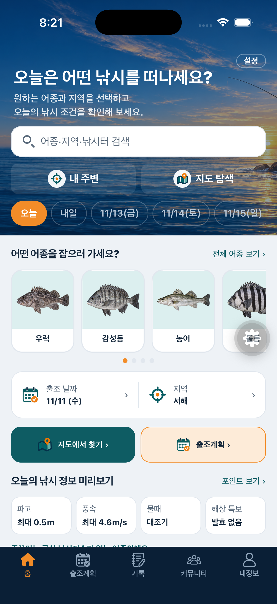
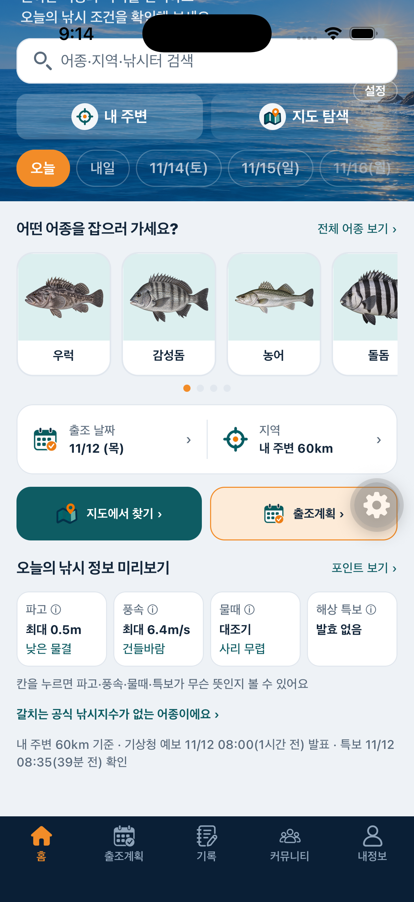
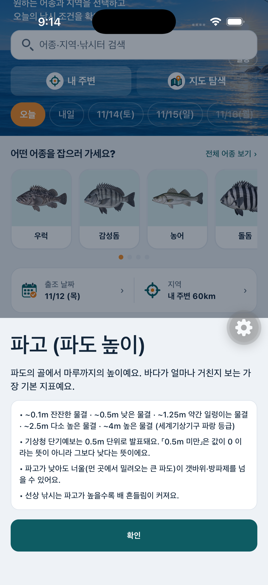
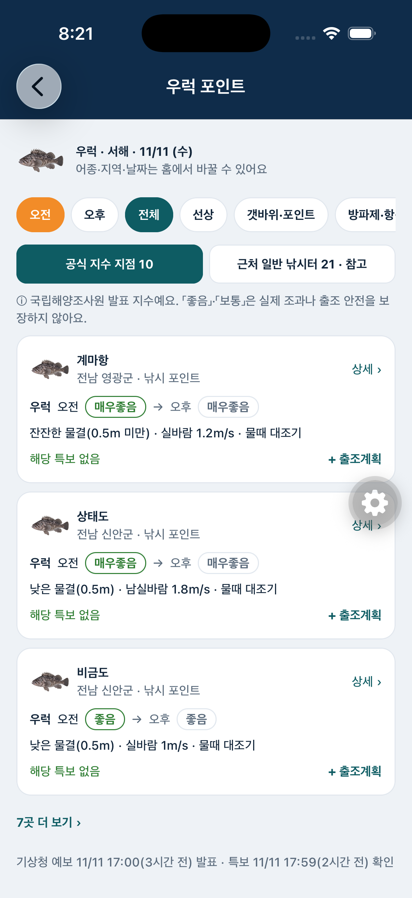
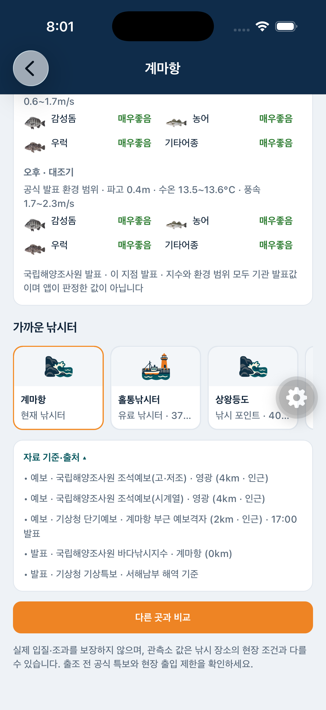
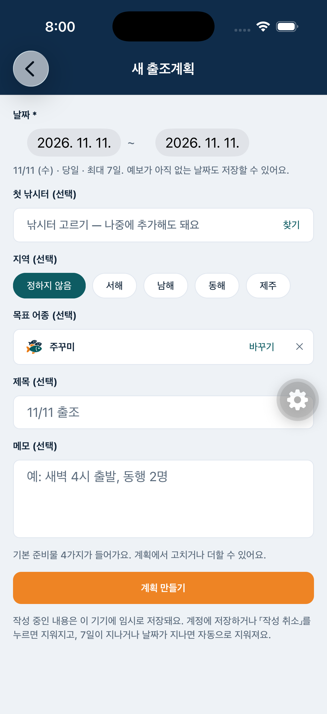
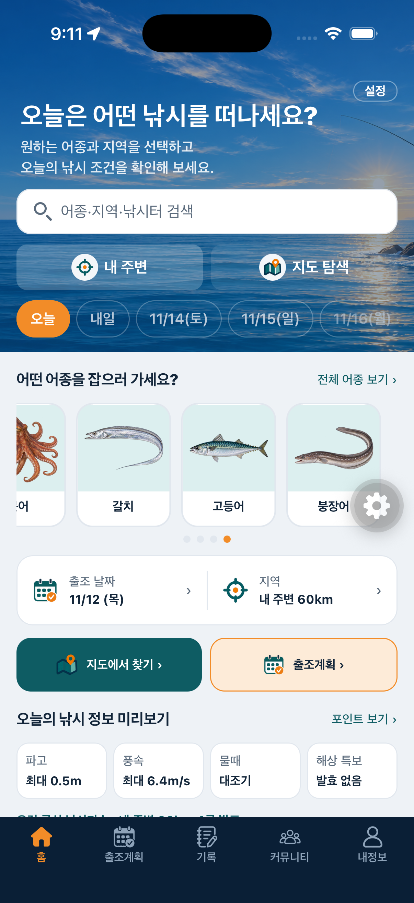
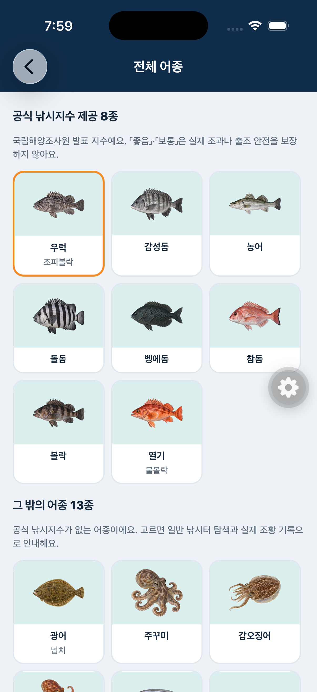
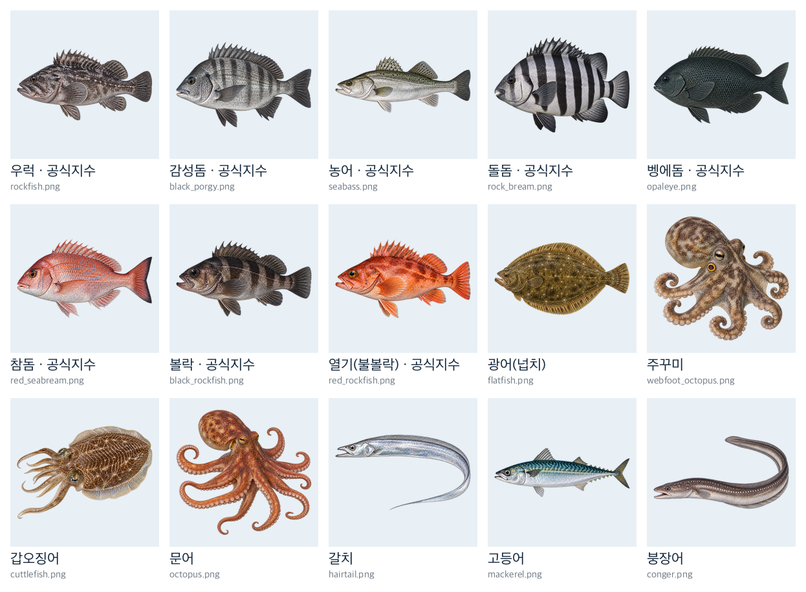

# 화면 설계 — 홈·어종 탐색

> 레퍼런스 홈 구조(「오늘은 어떤 낚시를 떠나세요?」)를 따른다. 설계가 바뀐 과정은 [설계 과정 이력](이력/어종_홈_설계_과정.md).

## 홈

| 첫 화면 | 오늘의 낚시 정보 · 쉬운 말 | 용어 풀이 |
|---|---|---|
|  |  |  |

1. 바다 배경 · 검색(어종·지역·낚시터) · 내 주변 · 지도 탐색 · 날짜
2. **어떤 어종을 잡으러 가세요?** — 실사 일러스트 카드(그림 + 이름), 고르면 주황 테두리, 다시 누르면 해제
3. **[출조 날짜 | 지역]** 상자 — 눌러서 선택 (지역: 내 주변 · 전국 · 서해 · 남해 · 동해 · 제주)
4. **[지도에서 찾기] [출조계획]**
5. **오늘의 낚시 정보** — 파고·풍속(지역 최대값)·물때·해상 특보 4칸 + 쉬운 말(낮은 물결·건들바람·사리 무렵). 칸을 누르면 [용어 풀이](../01_기획/용어_풀이.md)
6. 고른 어종 한 줄(공식 지수 제공 여부) + 자료 발표 시각

홈에는 낚시터 목록을 나열하지 않는다. 목록은 「포인트 보기」에서.

## 포인트 보기 · 상세 · 출조계획

| 포인트 보기 (우럭) | 낚시터 상세 — 공식 지수 | 출조계획 — 목표 어종 자동 입력 |
|---|---|---|
|  |  |  |

| 경우 | 보여주는 것 | 정렬 (앱이 점수를 만들지 않음) |
|---|---|---|
| 어종 상관없음 | 지역의 일반 낚시터 | 내 주변이면 가까운 순, 아니면 자료 연결 많은 곳 → 이름순 |
| 공식 지수 어종 (8종) | **[공식 지수 지점]** / **[근처 일반 낚시터 · 참고]** 탭, 오전→오후 등급 | 특보 발효 곳 맨 뒤 → 공식 등급 → 파고 → 풍속 → 이름 |
| 공식 지수 없는 어종 | 「공식 낚시지수 없음」 안내 + 일반 낚시터(어종 제목 없이) + 실제 조황 기록 수 | 어종 상관없음과 같음 |

- 근처 일반 낚시터: 「○○ 지점(2.1km) 지수 · 참고 — 이 낚시터에서 잡힌다는 뜻이 아니에요」, 등급은 회색, 어종 그림 대신 낚시터 아이콘
- 「좋음·보통은 조과·안전 보장이 아니에요」 안내를 항상 표시
- 상세 화면: 공식 지수 표에 어종 그림, 홈에서 고른 어종을 맨 위로. 파고·풍속·수온·물때·지수 「ⓘ 뜻 보기」
- 출조계획: 홈에서 고른 어종이 목표 어종으로 자동 입력 (어종 목록에 없는 6종은 기타 입력)

## 내 주변 · 전체 어종 · 어종 그림

| 내 주변 (GPS) | 전체 어종 | 어종 일러스트 15종 |
|---|---|---|
|  |  |  |

- 내 주변: 누를 때만 위치 권한 요청, 좌표는 기기 안에서 거리 계산에만, 저장하지 않음. 「내 주변 · ○○ 부근」으로 기준 위치 표시 (시뮬레이터는 테스트 좌표)
- 전체 어종: 공식 지수 8종 · 그 밖 13종. 그림이 없는 6종(노래미·전갱이·학꽁치·숭어·망둥어·무늬오징어)은 기본 아이콘
- 어종 그림: OpenAI 이미지 API(gpt-image-2.6-flare)로 만든 사실적 도감형 투명 PNG 15종, 검수 후 적용

## 확인 전

- 작은 화면(iPhone SE)·다크 모드
- 실제 아이폰 GPS
- 출조계획 상세 헤더의 목표 어종 그림

관련: [iOS 화면 검증](iOS_화면_검증.md) · [요구사항 요약](../01_기획/요구사항_요약.md)
