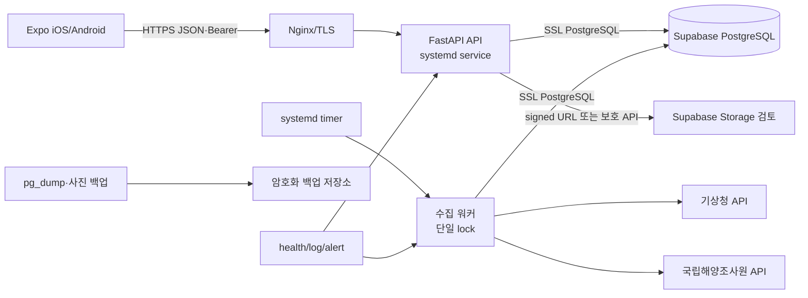

# 입질예보 Supabase·DigitalOcean 배포 전환 설계

> ⚠️ **이전 검토안** — 실제 배포 전에 작성한 문서입니다. 현재 구성은 Fly.io(서버) + Supabase(DB) + GitHub Actions(수집) 입니다 → [발표 자료](../06_개발환경/시스템_아키텍처.md) · [Fly 배포](../03_데이터/서버_배포.md)

작성일: 2026-11-11  
상태: 설계만 완료. 프로젝트 생성·결제·서버 생성·DB 이전은 하지 않음.

## 0. 결정 범위와 금지사항

운영 DB는 Supabase PostgreSQL을 사용하고, API 서버는 DigitalOcean Ubuntu Droplet을 우선 검토한다. 이번 문서는 현재 코드와 로컬 SQLite를 읽어 설계한 실행계획이다.

다음은 수행하지 않았다.

- Supabase 프로젝트 생성 또는 인증키 발급
- DigitalOcean Droplet 생성·결제·방화벽 변경
- SQLite 파일 변경·삭제·마이그레이션
- 기존 인증 방식 또는 Mac `launchd` 수집기 변경·중단
- 좌표·좌표 품질·검증 이력·사용자 데이터 수정

확인되지 않은 실제 운영 트래픽, DigitalOcean 리전별 지연시간, Supabase 프로젝트별 한도는 배포 전에 별도 측정한다.

## 1. 현재 구현 조사 결과

### 1.1 현재 저장소 구성

| 영역 | 확인된 구현 | 운영 전환 시 영향 |
|---|---|---|
| API | FastAPI, `/api/v1`, SQLAlchemy 2, Pydantic | `uvicorn` 뒤에 Nginx를 둔다 |
| DB | `DATABASE_URL`로 엔진 생성, 기본 SQLite | PostgreSQL 드라이버·풀·Alembic 필요 |
| 초기화 | `lifespan`에서 `init_db()` 실행, `create_all`과 누락 컬럼 추가 | 운영에서는 `create_all` 대신 버전 관리 마이그레이션 사용 |
| 수집 | `python -m app.jobs.collect`, `--loop` 3600초, 실패 60초·300초 재시도 | Mac launchd와 별개로 서버 systemd timer로 이전 |
| 인증 | 이메일+scrypt, Google ID token 검증, DB 세션 토큰 해시, 기기 UUID | 기존 API·계정 데이터를 그대로 유지하고 Supabase Auth는 선택 사항 |
| 사진 | Pillow로 EXIF 제거·1600px 축소 후 `MEDIA_DIR` 로컬 파일 저장 | 컨테이너/서버 디스크 대신 Storage 전환 검토 |
| 앱 | Expo 앱이 `EXPO_PUBLIC_API_URL`로 FastAPI만 호출 | 앱에 DB URL·Supabase service key를 넣지 않는다 |
| CORS | `APP_ENV=dev`일 때만 `*` | 운영에서는 앱 네이티브 요청과 관리 웹 origin을 제한 |

주요 확인 파일: `backend/app/core/config.py`, `core/db.py`, `main.py`, `models/`, `services/auth.py`, `services/photos.py`, `jobs/collect.py`, `clients/kma.py`, `clients/khoa.py`, `frontend/src/api/client.ts`, `api/upload.ts`.

### 1.2 로컬 SQLite 스냅샷(읽기 전용 확인)

확인 시점의 `backend/biteforecast.db`는 약 25MB, `backend/media`는 약 296KB였다. 수치는 운영 용량이 아니라 현재 로컬 스냅샷이다.

| 테이블 | 행 수 | 역할 |
|---|---:|---|
| `region` | 48 | 해역 |
| `place` | 231 | 낚시 장소 |
| `place_info` | 219 | 장소 부가정보 |
| `place_coord_check` | 543 | 좌표 검증 이력 |
| `station` | 210 | 기관 지점·격자 |
| `place_station` | 750 | 장소-관측소 역할별 매핑 |
| `fishing_index` | 3,781 | 공식 어종별 바다낚시지수 |
| `ocean_reading` | 71,832 | 파고·풍속·수온·기온·강수·하늘·강수형태 |
| `tide_forecast` | 13,056 | 시간별 조위 예측 |
| `tide_extreme` | 2,065 | 만조·간조 |
| `marine_warning_snapshot` | 11 | 특보 원문·파싱 스냅샷 |
| `app_user` / `account` / `auth_session` | 16 / 7 / 12 | 사용자·계정·세션 |
| `trip_plan` / `trip_stop` / `trip_checklist_item` | 4 / 7 / 16 | 출조계획 |
| `journal` / `journal_env_snapshot` | 6 / 24 | 낚시 기록·당시 환경 |
| `post` / `comment` / `post_like` / `content_report` | 8 / 0 / 0 / 0 | 커뮤니티 |
| `photo` | 5 | 현재 사진 모델 |
| `point_ledger` / `title` | 3 / 5 | 포인트·칭호 |
| `restriction` / `regulation_report` | 0 / 0 | 규제·오류 신고 |

추가로 SQLite에 `journal_photo`라는 과거 스키마 테이블(0건)이 남아 있으나 현재 ORM의 `Photo`는 `photo` 테이블을 사용한다. 마이그레이션 때 임의 삭제하지 않고, 백업·스키마 대조 후 “레거시 보존/아카이브/미사용 확인”을 결정한다.

### 1.3 관계·제약·인덱스

- `app_user` 1 : 1 `account`; `account.email`, `google_sub`, `nickname`, `nickname_key`는 UNIQUE다.
- 세션은 `auth_session.token_hash` UNIQUE이며 실제 토큰 원문은 DB에 저장하지 않는다.
- `place_station`의 복합 기본키는 `(place_id, role)`이고 관측소 거리를 저장한다.
- `station(provider, external_id)`, `fishing_index(station_id, day, period, species)`, `ocean_reading(station_id, metric, kind, t, issued_at)`, 조위 `(station_id, t, issued_at)`는 중복 방지 UNIQUE다.
- `post_like(post_id, user_id)`, `favorite(user_id, place_id)`는 복합 기본키다.
- 다수의 사용자 하위 데이터는 `CASCADE`, 공유 글·일지 연결은 `SET NULL`을 사용한다. PostgreSQL에서도 동일한 FK 동작을 명시적으로 검증한다.
- 시간은 `UTCDateTime`으로 UTC 저장·조회하고, KST는 API 표시/예보 대상 계산에만 사용한다.
- Enum은 SQLAlchemy `native_enum=False` 문자열 형태다. PostgreSQL native enum으로 자동 변환하지 않는다.

### 1.4 인증·사용자 데이터

이메일 가입은 scrypt 해시(`password_hash`)를 저장하고, Google 로그인은 Google JWKS로 ID token을 검증한 뒤 `google_sub`를 저장한다. 로그인 세션은 60일 기본 만료·활동 시 연장이다. 로그인 전 `X-Device-Id`의 `app_user`에 쌓인 기록을 가입 계정에 연결할 수 있다.

로그인 실패 제한 `_FAILS`는 프로세스 메모리 딕셔너리다. API를 여러 프로세스로 늘릴 때는 프로세스마다 분리되므로, 출시 전 Redis/DB 기반 제한 또는 단일 워커 정책을 결정한다. 이는 기존 인증을 바꾸는 작업이 아니라 확장 시 위험으로 기록한다.

### 1.5 수집기·최신성

현재 수집 범위는 코드에서 다음처럼 확인된다.

- 조석: 오늘 기준 `compare_days_back`~`compare_days_ahead`(기본 -3~+7일), 이미 있는 날짜는 재호출하지 않음
- 부이: 과거~오늘 실측, 결측은 `NULL`
- 기상청 단기예보: 가장 최근 발표분, WAV/WSD/TMP/POP/SKY/PTY, 지점별 예보 격자
- 바다낚시지수: 오늘부터 약 7일, 전국 응답에서 매핑된 지점만 저장, 6시간 이내면 건너뜀
- 특보: 매 실행 전국 스냅샷 1건, 최근 48개 유지
- 전체 실패 시 `runtime/collector-status.json`에 `failed/interrupted`를 기록하고, 파일 lock으로 중복 실행을 막음

수집 실패와 자료 만료는 `fetched_at`, `issued_at`, 예보 대상 `t`, 상태 파일의 마지막 성공·실패 시각으로 분리한다. 이 정책은 PostgreSQL로 옮긴 뒤에도 동일해야 한다.

## 2. 목표 아키텍처

DigitalOcean과 Supabase의 정확한 리전·왕복시간은 프로젝트가 생성되기 전에는 확인 불가다. 서울/싱가포르 등 후보 리전에서 API·DB 왕복 p50/p95를 측정하고, 지연이 큰 경우 Supabase 연결 방식과 Droplet 리전을 다시 선택한다.

## 3. SQLite → Supabase PostgreSQL 전환

### 3.1 전환 원칙

1. 원본 SQLite는 `backend/backups/`에 파일 복사와 SHA-256을 남긴다. 원본은 읽기 전용으로 보존한다.
2. 운영 PostgreSQL은 별도 프로젝트/별도 자격증명으로 둔다. 개발은 로컬 PostgreSQL 또는 별도 Supabase 프로젝트를 사용한다.
3. `Base.metadata.create_all()`로 운영 스키마를 만들지 않는다. Alembic의 순차 마이그레이션으로 생성한다.
4. 모든 행을 먼저 옮기고, 외래키·UNIQUE·행 수·NULL 분포·좌표·최신 시각을 대조한다.
5. 검증이 끝날 때까지 API와 Mac 수집기는 SQLite를 계속 사용한다. 승인된 전환 창에서만 운영 `DATABASE_URL`을 바꾼다.

### 3.2 테이블별 이전 방법

| 그룹 | 테이블 | 방법·주의 |
|---|---|---|
| 기준 데이터 | `region`, `place`, `place_info`, `station`, `place_station`, `species`, `title` | 현재 정수/문자열 ID를 유지해 FK와 앱 URL을 보존. 좌표와 거리 원문을 그대로 복사 |
| 좌표 이력 | `place_coord_check` | 543건 전체 append-only 복사. `grade`, `status`, `candidate_*`, `batch`, `checked_at`을 변경하지 않음 |
| 해황 | `fishing_index`, `ocean_reading`, `tide_forecast`, `tide_extreme`, `marine_warning_snapshot` | `NULL`을 0으로 변환하지 않음. `issued_at`, `fetched_at`, 대상 `t`를 UTC로 검증 |
| 사용자·인증 | `app_user`, `account`, `auth_session`, `favorite` | ID·이메일·Google sub·토큰 해시 보존. 토큰 원문 재발급 불필요 |
| 사용자 기능 | `trip_plan`, `trip_stop`, `trip_checklist_item`, `journal`, `journal_env_snapshot` | 계획·기록·환경 스냅샷의 FK와 soft delete 보존 |
| 커뮤니티 | `post`, `comment`, `post_like`, `content_report` | 신고·숨김·삭제 시각 보존. 공유된 일지 FK의 `SET NULL` 검증 |
| 사진·포인트 | `photo`, `point_ledger` | DB 메타데이터와 파일을 함께 검증. 포인트 원장은 append-only 유지 |
| 규제 | `restriction`, `regulation_report` | 현재 0건이어도 스키마와 제약을 이관 |
| 레거시 | `journal_photo` | 현재 ORM 미사용. 백업과 별도 보존 후 삭제 여부를 승인받음 |

### 3.3 자료형·SQL 차이

- SQLite `INTEGER PRIMARY KEY`와 PostgreSQL `INTEGER` identity/sequence의 차이를 고려한다. 기존 ID를 넣은 뒤 sequence를 `MAX(id)` 뒤로 보정한다.
- SQLite의 느슨한 Boolean·Enum·날짜 저장을 PostgreSQL의 `BOOLEAN`, 문자열 Enum, `DATE`, `TIME`, `TIMESTAMP`로 명시한다.
- `UTCDateTime`은 PostgreSQL에서 `TIMESTAMP WITHOUT TIME ZONE`에 UTC 값으로 저장하는 현행 의미를 유지한다. `TIMESTAMPTZ`로 바꾸려면 API·마이그레이션 전체 검증 후 별도 결정한다.
- `TEXT`, `VARCHAR`, `FLOAT`, `INTEGER`는 호환되지만 NaN/Infinity, 빈 문자열, 비정상 날짜를 사전 검사한다.
- PostgreSQL에서는 FK·UNIQUE·복합 인덱스를 먼저 만들고 대량 적재 시 일시적으로 검증 전략을 조정하되, 최종 전에는 반드시 활성화한다.

### 3.4 정합성 검증·롤백

검증 SQL/스크립트는 다음을 출력한다.

- 테이블별 행 수와 PK 중복
- 모든 FK 고아 행 수
- UNIQUE 후보 중복 수
- `place.lat/lon`, 품질 등급별 건수, `place_coord_check` 건수·최솟값/최댓값
- 사용자·포인트·계획·일지·게시글별 행 수
- 해황별 `NULL` 비율과 `issued_at/fetched_at/t` 범위
- 사진 파일의 `sha256`, 크기, DB 메타데이터 일치

검증 실패 시 API의 DB URL을 바꾸지 않는다. 전환 후 문제가 발견되면 PostgreSQL을 읽기 중지하고 SQLite 백업으로 API를 되돌린다. 사용자 데이터 삭제나 원본 덮어쓰기는 하지 않는다.

## 4. Supabase 연결·RLS·Auth·Storage 결정

### PostgreSQL 연결

DigitalOcean Droplet은 장기 실행 백엔드이므로 Supabase의 direct connection(IPv6) 또는 IPv4-only 환경의 session pooler를 후보로 둔다. 마이그레이션·`pg_dump`는 direct connection이 적합하고, 앱 API는 SQLAlchemy pool을 작게 설정한다. Supabase는 direct connection과 pooler의 IPv4/IPv6 조건이 다르므로 실제 Droplet 네트워크 확인 후 선택한다. 연결 문자열은 프로젝트 생성 후 Dashboard의 Connect에서 복사하며 추측으로 만들지 않는다.

- `sslmode=require` 이상을 사용하고, 가능하면 Supabase CA로 `verify-full`을 검토한다.
- SQLAlchemy `pool_size`, `max_overflow`, `pool_pre_ping`, `pool_recycle`을 운영 설정으로 분리한다.
- transaction pooler를 쓰면 prepared statement·세션 상태 제한이 있으므로 psycopg/SQLAlchemy 설정을 확인한다.
- API와 수집기가 별도 프로세스이면 합산 연결 수가 Supabase 한도를 넘지 않도록 API 2~5개, 워커 1개부터 측정한다.

공식 연결 지침: [Supabase PostgreSQL 연결](https://supabase.com/docs/guides/database/connecting-to-postgres), [연결 풀·한도](https://supabase.com/docs/guides/database/connecting-to-postgres/pooling-and-limits), [SSL](https://supabase.com/docs/guides/platform/ssl-enforcement).

### Supabase Auth 비교

|항목|현재 인증|Supabase Auth 도입|
|---|---|---|
|이메일·Google|FastAPI가 직접 처리|Supabase JWT/OAuth로 재설계|
|기존 계정|`app_user`·`account`·세션 그대로 보존|user UUID 매핑과 토큰 교환 필요|
|기기 데이터 연결|현재 구현되어 있음|커스텀 마이그레이션 필요|
|변경 위험|낮음|로그인·탈퇴·세션·약관 흐름 전면 검증 필요|

**결정**: 이번 전환에서는 Supabase Auth를 도입하지 않는다. 기존 인증을 유지하고, Supabase Auth는 추후 별도 RFC와 계정 매핑·앱 업데이트 계획이 승인될 때만 검토한다. Supabase의 `service_role` 키는 서버에만 두며 앱에 넣지 않는다.

### Supabase Storage 비교

현재는 업로드 시 Pillow로 EXIF/GPS를 제거한 JPEG를 `MEDIA_DIR/YYYY/MM/uuid.jpg`에 저장하고, `/photos/{id}`가 권한 확인 후 파일을 내려준다.

Storage로 옮길 경우에도 이 보안 흐름은 유지한다.

1. FastAPI가 업로드 검증·EXIF 제거·축소를 수행한다.
2. 처리된 파일만 비공개 bucket에 저장한다.
3. `photo.path`를 object key로 사용하거나 별도 key 컬럼을 추가한다(마이그레이션 승인 필요).
4. 앱에는 service key가 아닌 짧은 signed URL 또는 FastAPI 보호 URL만 전달한다.
5. 기존 `/photos/{id}` API 계약은 유지해 프론트 수정 범위를 줄인다.

초기에는 로컬 디스크와 Storage를 동시에 쓰지 않는다. Storage 전환 전 사진 파일 5건의 hash·크기·권한·조회 URL을 검증하고, 실패 시 기존 파일을 보존한다.

## 5. DigitalOcean Droplet 설계

### 5.1 사양 비교

|사양|장점|위험|판정|
|---|---|---|---|
|2GB RAM|FastAPI·수집기·Nginx·로그를 한 대에 운영할 여유, 비용 절감|동시 사진 처리와 백업 압박 시 여유 감소|**초기 권장**|
|4GB RAM|Pillow 이미지 처리, 테스트·마이그레이션, 동시 요청에 여유|비용 증가. 현재 측정상 필요하다는 근거 없음|트래픽·메모리 측정 후 증설|

현재 확인 가능한 근거는 DB 25MB, 미디어 296KB, 로컬 데이터 규모이며, 지속 CPU/RAM·동시 접속 측정값은 없다. 따라서 2GB를 시작점으로 하고, `memory_available`, API p95, 수집 시간, OOM 발생 여부를 7일 관찰한다. 4GB로 올리는 기준은 OOM, 사진 처리 동시 실패, 수집 주기 초과, swap 지속 사용으로 명시한다. 정확한 Droplet 상품·가격은 생성 직전에 공식 요금표를 확인한다.

### 5.2 프로세스

- `biteforecast-api.service`: `uvicorn app.main:app --host 127.0.0.1 --port 8001`, `Restart=on-failure`, 비밀값은 `EnvironmentFile` 권한 600
- `biteforecast-collector.service`: `python -m app.jobs.collect` 1회 실행, `--loop` 금지
- `biteforecast-collector.timer`: `OnCalendar` 또는 `OnUnitActiveSec=1h`, `Persistent=true`
- `nginx`: 80→443 redirect, TLS, `/api/v1` reverse proxy, 업로드 body 제한, access log 민감정보 점검
- `ufw`: SSH 허용은 관리자 IP/키 정책을 우선하고, 80/443만 공개. PostgreSQL 포트는 공개하지 않음

서버 재시작 시 API는 systemd가 자동 복구하고, timer는 `Persistent=true`로 꺼져 있던 동안의 실행을 한 번 보완한다. 단, 공공 API 호출량이 급증하지 않도록 보완 실행에도 lock과 최근 성공 시각 검사를 둔다.

### 5.3 네트워크

DigitalOcean과 Supabase 리전 조합은 실제 프로젝트 생성 전 미확인이다. 후보 조합별 `health`·단순 SELECT·수집 트랜잭션의 p50/p95와 실패율을 측정한다. Droplet이 IPv4-only이면 Supabase shared session pooler를 우선 검토하고, IPv6가 안정적이면 direct connection을 검토한다. API 앱은 클라이언트에게 Supabase 주소를 노출하지 않는다.

## 6. Mac launchd → DigitalOcean systemd timer

현재 Mac의 launchd는 변경·중단하지 않는다. 서버 수집기 검증이 끝나고 실제 전환 승인을 받은 뒤에만 이중 수집을 막기 위한 운영 전환 창을 만든다.

### 주기 설계(초안)

|데이터|현재 코드|서버 초안|근거·주의|
|---|---|---|---|
|기상청 파고·풍속·기온·강수·하늘|최신 base 발표분|1시간마다 확인|새 발표분이 있을 때만 저장, API 호출량 제한 |
|해상 특보|매 실행|15~30분 또는 1시간|특보 수시 발표, `issued_at`과 `fetched_at` 분리|
|바다낚시지수|6시간 이내면 skip|6시간|기관 발표값을 변경하지 않음|
|조위|이미 있는 날짜 skip|하루 1회 + 대상일 보강|천문조 재호출 절약|
|부이 실측|과거~오늘|1~3시간|결측은 NULL, 관측 시각 기준|

실제 주기는 API 제공주기·호출 한도 확인 후 확정한다. 모든 실행은 `collector.lock`과 systemd `flock` 중 하나의 단일 잠금만 사용하고, timeout·60초/300초 재시도·최종 상태 파일을 유지한다. 실패해도 이전 자료를 새 자료로 표시하지 않으며, `collection_failed`와 `stale`를 함께 반환할 수 있어야 한다.

### 상태·알림

- 시작: `last_started_at`
- 데이터셋별 성공/실패: stats와 warning collection
- 주기 성공: `last_success_at`, `last_completed_at`
- 최종 실패/중단: `last_failure_at`, `consecutive_failures`, `last_error`(키 마스킹)
- API `/health`는 프로세스 생존, 별도 수집 상태 endpoint는 자료 신선도를 표시
- 2회 연속 실패·특보 stale·디스크 80%·DB 연결 오류를 알림 조건으로 둔다

API 서버와 워커는 같은 PostgreSQL을 사용하지만 각 주기별 트랜잭션을 짧게 commit한다. 수집기에서 `delete→insert`하는 대상은 동일한 station/day 범위로 제한하고, 사용자 테이블은 절대 수정하지 않는다.

## 7. 보안·개인정보·백업

- 모바일 앱에는 Supabase DB URL, DB 비밀번호, `service_role`, `ADMIN_TOKEN`, 공공 API 키를 넣지 않는다.
- Supabase RLS는 FastAPI가 DB owner/service role로 직접 접근하는 경우에도 “앱이 Supabase Data API를 직접 호출하지 않도록” 원칙을 세운다. 필요 시 별도 제한 role과 RLS 정책을 설계한다.
- FastAPI의 Bearer 세션·Google 검증·이메일 scrypt·기기 UUID 흐름은 유지한다.
- 운영 CORS는 `*` 금지. 네이티브 앱 요청은 CORS 대상이 아니므로 관리자 웹 origin만 허용한다.
- SSH는 키 인증, root 로그인 차단, 자동 보안 업데이트, fail2ban/로그 점검을 적용한다.
- Nginx TLS 자동 갱신, 업로드 MIME·용량·이미지 디코딩 검사, EXIF 제거를 유지한다.
- Supabase DB 일일 `pg_dump`와 사진 object 백업을 별도 저장소에 암호화한다. 월 1회 복원 테스트를 완료하기 전 “백업 완료”로 표시하지 않는다.
- 백업에는 사용자 개인정보가 포함될 수 있으므로 접근 권한·보존기간·삭제 정책을 문서화한다.

## 8. 예상 비용·운영 위험

|항목|초기 예상|비고|
|---|---:|---|
|DigitalOcean 2GB Droplet|유료, 정확한 금액은 선택 리전·상품 확인|API·워커·Nginx 시작점|
|Supabase PostgreSQL|선택 요금제에 따라 변동|무료 한도·일시정지·백업 정책을 가입 전 확인|
|도메인|연간 유료|선택 사항이나 HTTPS 운영에 권장|
|오브젝트 저장소|사용량 기반|사진 증가에 따라 변동|
|모니터링·메일|초기 무료/저비용 후보|알림 누락 여부를 검증해야 함|

가장 큰 위험은 (1) Supabase 연결 수·IPv4/IPv6 불일치, (2) SQLite의 느슨한 데이터가 PostgreSQL 제약에서 거부되는 문제, (3) 사진 로컬 파일과 DB 메타데이터 불일치, (4) API·수집기 동시 실행으로 인한 호출량 초과, (5) 단일 Droplet 장애다. 비용은 실제 계정·리전·요금제 확인 전 확정하지 않는다.

## 9. 단계별 실행·검증 체크리스트

### A. 설계 승인 전(현재)

- [x] 코드·모델·로컬 DB를 읽기 전용으로 조사
- [x] 현재 테이블·행 수·관계·제약·사진 구조 기록
- [x] Supabase Auth를 이번 범위에서 제외
- [x] Supabase Storage 전환은 보호 API 계약 유지 조건으로 보류
- [x] Mac launchd·SQLite·사용자 데이터 보존

### B. 구현 승인 후, 로컬에서

- [ ] Alembic 기반 PostgreSQL 스키마 생성
- [ ] `psycopg` 드라이버·SQLAlchemy pool 설정 추가
- [ ] SQLite export/import 및 검증 스크립트 작성
- [ ] `journal_photo` 레거시 처리 결정
- [ ] Dockerfile·systemd unit·timer·Nginx 템플릿 작성
- [ ] 사진 Storage adapter를 추가하되 기존 로컬 adapter와 병행 테스트

### C. Supabase 프로젝트 생성 후

- [ ] 개발/운영 프로젝트 분리
- [ ] 리전·IPv4/IPv6·direct/session pooler 선택
- [ ] SSL CA와 연결 문자열을 Secret에 저장
- [ ] RLS/service role 접근 경계 검토
- [ ] 빈 스키마 마이그레이션 및 rollback 테스트

### D. 데이터 이전 리허설

- [ ] SQLite 백업·해시 기록
- [ ] staging PostgreSQL로 전체 import
- [ ] 모든 정합성 출력과 API read-only 비교
- [ ] 219 장소·543 좌표 검증 이력·사용자/포인트/기록 보존 확인
- [ ] 사진 5건 파일·메타데이터·권한 대조
- [ ] 실패 주입 후 rollback 확인

### E. 운영 전환 승인 후

- [ ] DigitalOcean 2GB Droplet 생성·방화벽·SSH
- [ ] API service, collector service, timer, Nginx, TLS 등록
- [ ] 수집기 1회 검증 후 정기 timer 검증
- [ ] Mac launchd와 중복되지 않는 전환 시점 확정
- [ ] `/health`, 신선도, 알림, 백업 복원 확인
- [ ] 앱의 `EXPO_PUBLIC_API_URL`을 HTTPS API로 변경하고 iOS 빌드 검증

## 10. 코드 재사용·수정 파일

### 그대로 재사용

- `backend/app/models/`, 대부분의 `schemas/`, `services/`, `routers/`
- 공공 API 클라이언트와 수집 데이터의 최신성·결측·특보 안전 정책
- FastAPI 인증 API와 Expo API 계약
- 원본 좌표·품질·검증 이력·추천 기준

### 수정 예상

- `backend/app/core/config.py`: 운영 DB URL, pool, SSL, 환경별 media backend
- `backend/app/core/db.py`: PostgreSQL engine 옵션, 운영 `init_db` 제거, migration-only
- `backend/app/models/base.py`: 날짜·시간 저장 전략의 PostgreSQL 테스트
- `backend/app/services/photos.py`, `routers/photos.py`: Storage adapter와 signed/protected URL
- `backend/app/jobs/collector_status.py`, `jobs/collect.py`: 서버 상태 경로·systemd 종료코드·알림 연계
- `backend/requirements.txt`, `pyproject.toml`: PostgreSQL 드라이버·Alembic 추가
- 신규: `backend/alembic/`, `backend/ops/systemd/*.service`, `*.timer`, `nginx` 템플릿, Dockerfile
- `frontend/src/api/client.ts`: 배포 HTTPS URL만 환경별로 주입. DB/관리자 키 코드는 추가하지 않음

## 11. 배포 전 사용자가 결정할 사항

1. DigitalOcean Droplet 리전과 2GB 시작 여부
2. Supabase 개발/운영 프로젝트 분리 및 요금제
3. Supabase direct connection(IPv6)과 session pooler(IPv4) 중 선택
4. 사진을 Supabase Storage로 옮길 시점과 보존기간
5. 도메인·TLS·알림 메일·백업 저장소 예산
6. 기존 Mac 수집기와 서버 수집기의 전환 날짜
7. PostgreSQL 마이그레이션 리허설과 실제 전환 승인자
8. 기존 인증 유지(권장) 또는 Supabase Auth 별도 전환 프로젝트 여부

## 공식 참고 문서

- [Supabase PostgreSQL 연결 방식·IPv4/IPv6·마이그레이션](https://supabase.com/docs/guides/database/connecting-to-postgres)
- [Supabase 연결 풀과 한도](https://supabase.com/docs/guides/database/connecting-to-postgres/pooling-and-limits)
- [Supabase PostgreSQL SSL 강제](https://supabase.com/docs/guides/platform/ssl-enforcement)
- [DigitalOcean Droplet 요금](https://www.digitalocean.com/pricing/droplets)
- [DigitalOcean 방화벽](https://docs.digitalocean.com/products/networking/firewalls/)
