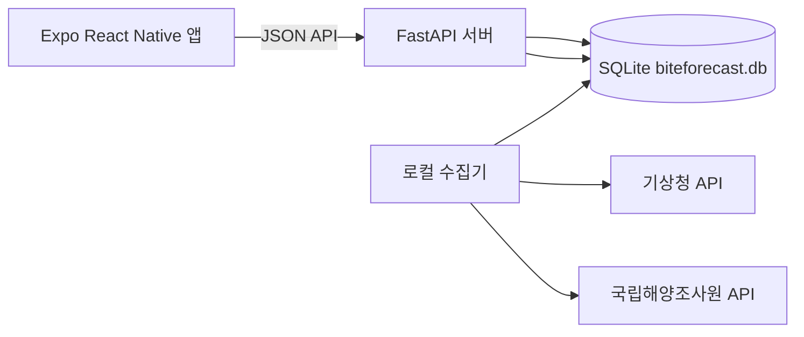
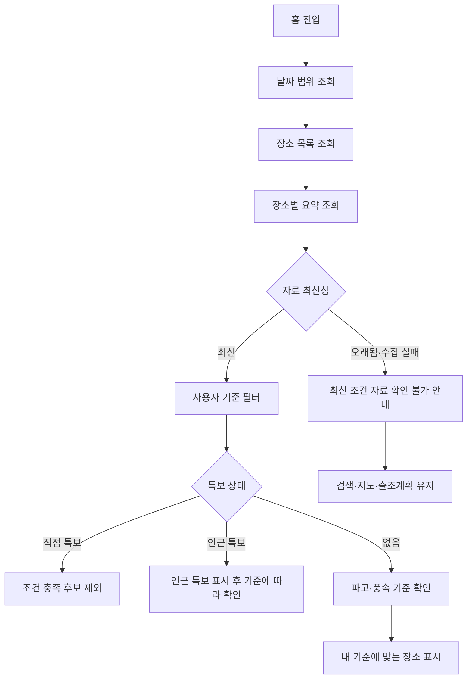
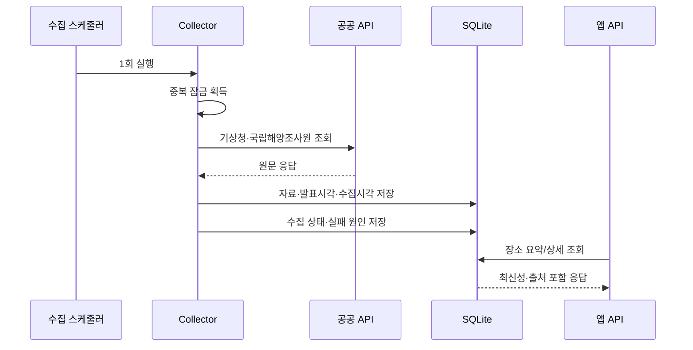

# 시스템 아키텍처·주요 플로우차트

## 1. 현재 아키텍처

- 앱은 공공 API를 직접 호출하지 않는다.
- 인증키는 backend 환경변수에만 둔다.
- 수집기가 API 응답을 DB에 저장하고, 앱은 DB 기반 API를 조회한다.
- 현재는 개발 Mac 로컬 실행이며 외부 서버 배포는 하지 않았다.

## 2. 홈 조회 플로우

## 3. 수집 플로우

## 4. 발표 시 설명할 제한

- `stale`은 “현재 갱신 중”이 아니라 최신성 기준을 넘긴 상태다.
- 학교 네트워크·Expo Go 실기기에서는 로컬 API 접근이 제한될 수 있다.
- SQLite와 로컬 사진 저장 구조는 발표용 개발 환경이며 운영 배포 구조가 아니다.
- 실제 조황·어획 확률을 예측하지 않는다.
