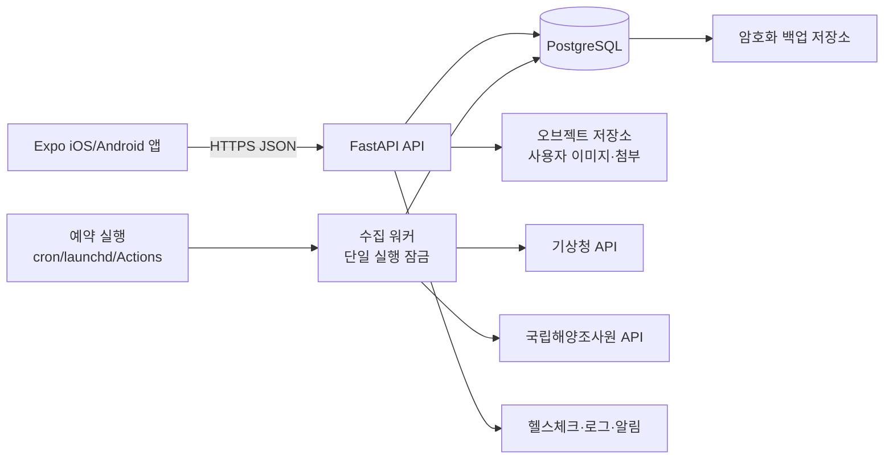

# 입질예보 저비용 출시용 기술 아키텍처

작성일: 2026-11-11  
상태: 설계·비용 검토(외부 계정 생성, 결제, 배포 전)

## 1. 결론

무료 요금제는 발표·개발·클로즈드 베타에는 적합하지만, 앱스토어 출시 후의 상시 수집과 백업을 보장하지 않는다. 따라서 다음 2단계로 간다.

- **1단계(발표/검증)**: Render Free에 FastAPI를 올리고 Supabase Free PostgreSQL을 사용한다. 데이터 수집은 GitHub Actions의 예약 실행 또는 수동 실행으로 분리한다. 단, Render는 유휴 시 정지되고 Supabase 무료 프로젝트도 장기 비활동 시 일시정지될 수 있으므로 운영 서비스로 표시하지 않는다.
- **2단계(출시/클로즈드 베타 이후)**: 소형 상시 실행 VPS 1대에 Docker Compose로 API·수집 워커를 운영하고 PostgreSQL을 둔다. 예산을 최우선으로 하면 DigitalOcean 512MiB Droplet(공식 표기 월 $4부터)을 검토하되, 메모리 여유와 백업 비용을 포함해 실제 선택한다. 단일 VPS는 장애 단일 지점이므로 외부 백업을 반드시 둔다.

현재 FastAPI 인증과 API 계약은 유지한다. Supabase Auth로 즉시 교체하지 않고, 먼저 PostgreSQL만 사용해 사용자 데이터 마이그레이션 위험을 줄인다.

## 2. 논리 구성

### 구성 원칙

1. API 서버와 수집 워커를 분리한다. 웹 프로세스 안에서 `--loop` 수집을 실행하지 않아 중복 호출과 재시작 문제를 막는다.
2. `수집 시작/성공/실패 시각`, `공식 발표 시각`, `예보 대상 시각`을 각각 보존한다. 오래된 자료를 최신 자료로 표시하지 않는다.
3. 특보는 예보와 독립적으로 만료·적용 해역을 판정한다. `none`은 “연결된 특보 없음”이지 “안전”이 아니다.
4. 장소 좌표·좌표 품질·검증 이력·추천 보류 정책은 마이그레이션에서도 원문 그대로 보존한다.
5. 사용자 업로드 이미지는 컨테이너 로컬 디스크가 아니라 오브젝트 저장소에 둔다. DB에는 키·메타데이터만 저장한다.

## 3. 공급자 비교

|안|서버|DB|장점|주의점|용도|
|---|---|---|---|---|---|
|A|Render Free|Supabase Free|가입 후 빠른 발표, 관리형 DB|Render 유휴 정지, Supabase 비활동 일시정지·용량 제한, 상시 수집 부적합|발표/시연|
|B|Railway Hobby|Supabase Free 또는 같은 PostgreSQL|배포가 단순하고 워커 분리 쉬움|무료 크레딧은 상시 운영을 보장하지 않음, Hobby부터 유료|클로즈드 베타|
|C(권장)|소형 VPS|VPS 내부 PostgreSQL + 외부 암호화 백업|상시 API·수집 가능, 비용 예측 가능|OS 보안·패치·백업을 직접 운영, 단일 장애점|실제 출시 초기|
|D|Oracle Always Free|VM 내부 PostgreSQL|조건 충족 시 컴퓨트가 무료|가입 시 결제수단 확인, 지역별 용량 부족, 운영 난이도와 복구 책임이 큼|비용 실험용, 출시 주력으로는 비권장|

공식 제한과 가격은 변경될 수 있으므로 가입 직전에 다시 확인한다. Render 무료 웹 서비스는 15분 동안 요청이 없으면 정지하며 무료 Postgres는 30일 후 만료·백업 미제공이다. Supabase Free는 프로젝트당 DB 500MB, 월 egress 5GB 등의 제한과 비활동 일시정지가 있다. Railway 무료 플랜은 월 $1 크레딧이며 상시 서버 비용을 보장하지 않는다. DigitalOcean 공식 요금표는 512MiB·1vCPU Droplet을 월 $4부터 표시한다. Oracle Always Free는 지역의 호스트 용량 부족이 발생할 수 있다.

## 4. 데이터베이스 전환 계획(SQLite → PostgreSQL)

### 절대 보존 대상

- `place.lat/lon`, 좌표 품질 등급, `place_coord_check` 543건
- 기존 사용자·포인트·출조계획·기록
- 추천 기준과 특보 안전 정책

### 단계

1. `backend/backups/`에 SQLite 원본 파일과 SHA-256을 보관한다.
2. SQLAlchemy 모델의 SQLite/PostgreSQL 호환성을 확인하고 Alembic 초기 마이그레이션을 만든다.
3. PostgreSQL에 스키마를 만든 뒤 테이블별 행 수·최솟값/최댓값·좌표·외래키를 대조한다.
4. 읽기 전용 검증 기간에는 SQLite와 PostgreSQL 응답을 샘플 비교한다.
5. 수집기를 중지한 짧은 전환 창에서 최종 증분을 옮기고 API의 `DATABASE_URL`만 변경한다.
6. 이상 시 PostgreSQL을 내리고 SQLite 백업으로 되돌린다. 삭제·덮어쓰기는 승인 후에만 수행한다.

## 5. 운영·보안 최소 기준

- API는 HTTPS만 공개하고 CORS는 앱 도메인과 개발 주소로 제한한다.
- 인증키·관리자 토큰은 공급자의 Secret/환경변수에만 둔다. 로그·스크린샷·Git에 남기지 않는다.
- `/health`와 수집 상태(마지막 성공/실패/자료 신선도)를 분리해 제공한다.
- 수집 워커는 lock으로 한 번에 하나만 실행하고, API별 재시도·백오프·호출량 제한을 적용한다.
- DB 일일 백업과 월 1회 복구 리허설을 운영한다. 백업 성공을 확인하기 전 원본을 삭제하지 않는다.
- 개인정보는 최소 수집하고, 사용자 이미지에는 파일 크기·형식·악성 파일 검사를 적용한다.

## 6. 출시 순서와 비용 통제

1. **현재**: 문서화·Dockerfile·환경변수 분리·PostgreSQL 호환 테스트만 진행한다. 외부 계정이나 결제는 하지 않는다.
2. **발표**: Render Free + Supabase Free에 비운영 라벨로 임시 배포한다. 수집 지연 시 앱은 장소 탐색을 계속 제공하되 조건 추천을 만들지 않는다.
3. **베타**: 상시 실행 VPS 또는 Railway Hobby를 선택하고 워커를 별도 프로세스로 운영한다. 도메인·TLS·백업을 먼저 붙인다.
4. **앱 출시**: 사용량을 확인한 뒤 VPS 사양을 올리거나 관리형 PostgreSQL과 모니터링을 추가한다. 무료 요금제만으로 SLA를 약속하지 않는다.

## 7. 공식 참고 링크

- [Render Free 서비스 제한](https://render.com/docs/free)
- [Supabase 요금·무료 한도](https://supabase.com/pricing)
- [Railway 요금제](https://docs.railway.com/reference/pricing/plans)
- [DigitalOcean Droplet 요금](https://www.digitalocean.com/pricing/droplets)
- [Oracle Cloud Always Free](https://docs.oracle.com/en-us/iaas/Content/FreeTier/freetier_topic-Always_Free_Resources.htm)
- [GitHub Actions 공개 저장소 과금](https://docs.github.com/en/billing/concepts/product-billing/github-actions)

## 8. 승인 대기 사항

- 1단계 임시 배포 공급자(Render/Supabase) 선택
- 2단계 상시 운영 공급자(VPS/Railway)와 월 예산
- PostgreSQL 마이그레이션 실행 승인
- 외부 계정 생성·결제수단 등록·도메인 구입 여부

위 항목이 정해지기 전에는 외부 배포나 결제를 진행하지 않는다.
