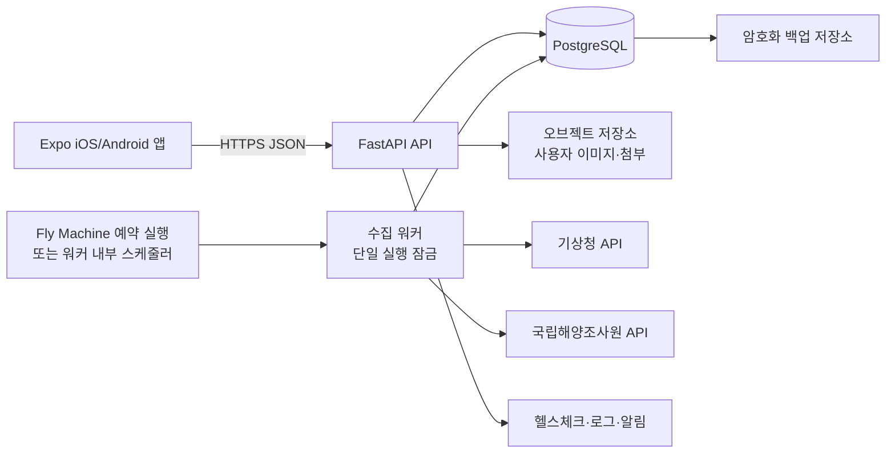

# 입질예보 저비용 출시용 기술 아키텍처

작성일: 2026-11-11  
상태: 설계·비용 검토(외부 계정 생성, 결제, 배포 전)

## 1. 결론

Fly.io를 주 서버 플랫폼으로 사용한다. 다만 Fly.io는 “무료 서버”가 아니라 사용량 기반 과금 플랫폼이므로, 결제수단 등록과 비용 상한 설정이 필요하다. 따라서 다음 2단계로 간다.

- **1단계(발표/검증)**: Fly Machine 1대에 FastAPI를 배포하고, DB는 기존 SQLite를 임시로 사용하지 않는다. SQLite를 써야 한다면 반드시 단일 Machine과 Fly Volume 1개에 고정하고, 외부 백업을 별도로 둔다.
- **2단계(출시/클로즈드 베타 이후)**: Fly Machine을 API와 수집 워커로 분리하고 PostgreSQL로 전환한다. Fly Managed Postgres는 백업·고가용성을 제공하지만 Basic이 월 $38부터이므로 초기 예산에는 부담이다. 초기에는 외부 관리형 PostgreSQL 또는 별도 PostgreSQL Machine을 비교한 뒤 선택한다.

현재 FastAPI 인증과 API 계약은 유지한다. Supabase Auth로 즉시 교체하지 않고, 먼저 PostgreSQL만 사용해 사용자 데이터 마이그레이션 위험을 줄인다.

## 2. 논리 구성

### 구성 원칙

1. API 서버와 수집 워커를 분리한다. 웹 프로세스 안에서 `--loop` 수집을 실행하지 않아 중복 호출과 재시작 문제를 막는다.
2. `수집 시작/성공/실패 시각`, `공식 발표 시각`, `예보 대상 시각`을 각각 보존한다. 오래된 자료를 최신 자료로 표시하지 않는다.
3. 특보는 예보와 독립적으로 만료·적용 해역을 판정한다. `none`은 “연결된 특보 없음”이지 “안전”이 아니다.
4. 장소 좌표·좌표 품질·검증 이력·추천 보류 정책은 마이그레이션에서도 원문 그대로 보존한다.
5. 사용자 업로드 이미지는 컨테이너 로컬 디스크가 아니라 오브젝트 저장소에 둔다. DB에는 키·메타데이터만 저장한다.

## 3. 공급자 비교

|안|서버|DB|장점|주의점|용도|
|---|---|---|---|---|---|
|A(선택)|Fly Machine|외부 PostgreSQL|API·워커를 같은 플랫폼에서 운영, 리전 선택 가능|Machine·볼륨·egress가 별도 과금, 운영자가 백업 책임|발표/클로즈드 베타|
|B|Fly Machine|Fly Managed Postgres|백업·고가용성·커넥션 풀링 제공|Basic 월 $38부터라 초기 비용이 큼|사용자 증가 후|
|C|Fly Machine|자체 PostgreSQL Machine|가장 저렴하게 구성 가능|DB 장애·복구·보안을 직접 운영, 단일 장애점|개발/검증 전용|

공식 가격은 변경될 수 있으므로 배포 직전에 다시 확인한다. Fly.io 공식 표 기준 shared-cpu-1x 256MB Machine은 월 약 $2.19, 512MB 2x는 약 $4.39이며, 볼륨은 GB·월 단위, 아시아태평양 egress도 별도 과금이다. Fly Managed Postgres Basic은 월 $38부터이고 저장공간도 별도다. 따라서 API와 수집 워커를 처음부터 여러 대로 늘리지 않고, 한 Machine·한 리전·예산 알림으로 시작한다.

## 4. 데이터베이스 전환 계획(SQLite → PostgreSQL)

### 절대 보존 대상

- `place.lat/lon`, 좌표 품질 등급, `place_coord_check` 543건
- 기존 사용자·포인트·출조계획·기록
- 추천 기준과 특보 안전 정책

### 단계

1. `backend/backups/`에 SQLite 원본 파일과 SHA-256을 보관한다.
2. SQLAlchemy 모델의 SQLite/PostgreSQL 호환성을 확인하고 Alembic 초기 마이그레이션을 만든다.
3. PostgreSQL에 스키마를 만든 뒤 테이블별 행 수·최솟값/최댓값·좌표·외래키를 대조한다.
4. 읽기 전용 검증 기간에는 SQLite와 PostgreSQL 응답을 샘플 비교한다.
5. 수집기를 중지한 짧은 전환 창에서 최종 증분을 옮기고 API의 `DATABASE_URL`만 변경한다.
6. 이상 시 PostgreSQL을 내리고 SQLite 백업으로 되돌린다. 삭제·덮어쓰기는 승인 후에만 수행한다.

## 5. 운영·보안 최소 기준

- API는 HTTPS만 공개하고 CORS는 앱 도메인과 개발 주소로 제한한다.
- 인증키·관리자 토큰은 공급자의 Secret/환경변수에만 둔다. 로그·스크린샷·Git에 남기지 않는다.
- `/health`와 수집 상태(마지막 성공/실패/자료 신선도)를 분리해 제공한다.
- 수집 워커는 lock으로 한 번에 하나만 실행하고, API별 재시도·백오프·호출량 제한을 적용한다.
- DB 일일 백업과 월 1회 복구 리허설을 운영한다. 백업 성공을 확인하기 전 원본을 삭제하지 않는다.
- 개인정보는 최소 수집하고, 사용자 이미지에는 파일 크기·형식·악성 파일 검사를 적용한다.

## 6. Fly.io 배포 구조와 비용 통제

1. **현재**: `fly.toml`, Dockerfile, 환경변수 목록만 준비한다. 외부 계정·결제·배포는 승인 전 진행하지 않는다.
2. **발표**: `shared-cpu-1x` 256~512MB 단일 Machine으로 API를 검증한다. 수집기는 API 프로세스에 넣지 않고 별도 일회성 Machine/예약 실행으로 둔다.
3. **베타**: API Machine과 수집 워커 Machine을 분리하고, PostgreSQL 전환·TLS·도메인·백업을 먼저 완료한다.
4. **앱 출시**: DB 백업 복구 리허설, 비용 알림, 로그 보존, 장애 시 추천 중단 정책을 확인한 뒤 사양과 Machine 수를 늘린다.

### Fly.io에서 지켜야 할 사항

- 컨테이너 파일시스템은 영구 DB로 사용하지 않는다. SQLite를 임시로 유지할 경우 Fly Volume 1개에만 쓰고 정기 백업·복구 검증을 둔다.
- API와 워커가 동시에 같은 DB를 변경하지 않도록 수집 잠금과 단일 실행을 유지한다.
- `fly scale count`로 무심코 복제하지 않는다. SQLite 단계에서는 반드시 1대만 허용한다.
- 외부 API 키와 DB URL은 `fly secrets set`으로 주입하고 로그에 출력하지 않는다.
- 한국 사용자 지연시간을 확인해 가까운 리전을 선택하되, 데이터 위치·공공 API 호출 제한을 먼저 검증한다.

## 7. 공식 참고 링크

- [Fly.io 공식 요금](https://fly.io/pricing/)
- [Fly.io 리소스 요금 설명](https://fly.io/docs/about/pricing/)
- [Fly.io Managed Postgres](https://fly.io/docs/mpg/)
- [Fly.io 앱 배포 안내](https://fly.io/learn/deploy-without-dockerfile/)

## 8. 승인 대기 사항

- Fly.io 조직·리전·월 예산 상한
- Fly Machine만 사용할지 Managed Postgres를 사용할지
- PostgreSQL 마이그레이션 실행 승인
- 외부 계정 생성·결제수단 등록·도메인 구입 여부

위 항목이 정해지기 전에는 외부 배포나 결제를 진행하지 않는다.
