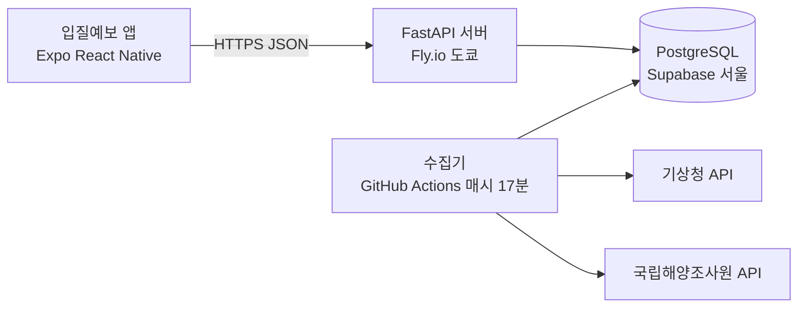
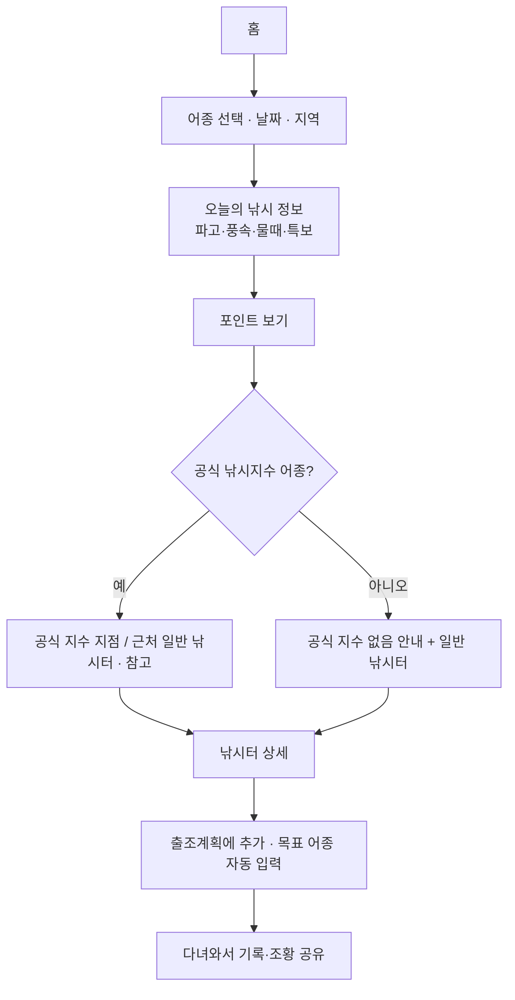
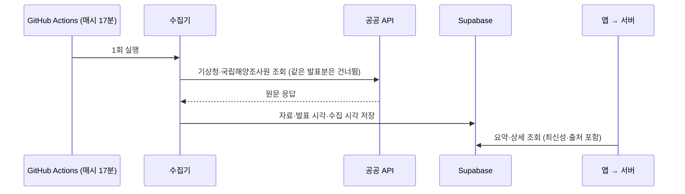

# 시스템 아키텍처

## 구성

| 구성 | 내용 | 자세히 |
|---|---|---|
| 앱 | React Native + Expo(iOS 개발 빌드), Expo Router. 공공 API 를 직접 부르지 않고 서버 API 만 조회 | [화면 설계](../05_UX/화면_설계.md) |
| 서버 | FastAPI · `https://biteforecast-api.fly.dev/api/v1` · 요청 없으면 자동 정지 | [서버 배포](../03_데이터/서버_배포.md) · [API 명세](../02_명세/API_명세.md) |
| DB | Supabase PostgreSQL(서울) · Alembic 으로 구조 관리 · 외부 공개 권한 차단 | [DB (Supabase)](../03_데이터/DB_Supabase.md) |
| 수집 | GitHub Actions 가 매시 17분 공공 API 를 받아 DB 에 저장 — 개발 Mac 이 꺼져도 동작 | [자동 수집](자동_수집.md) |
| 인증키 | 서버·수집기의 비밀값(Fly secrets, GitHub Secrets)에만. 앱 번들·Git 에 없음 | [외부 API](../03_데이터/외부_API.md) |

## 홈 조회 흐름

## 수집 흐름

## 데이터 신뢰 장치

- **좌표 검증**: 낚시터 219곳 좌표 품질 등급(A~D)·검증 이력. 의심 좌표는 해황 연결·추천에서 제외 → [좌표 품질 검증](../03_데이터/2026-11-09_좌표품질_검증보고서.md)
- **특보 상태 구분**: 특보 없음 / 다른 해역에만 있음 / 적용 해역 모름 / 자료 만료 / 수집 실패를 서로 다르게 표시
- **자료 최신성**: 예보·특보가 오래되면 조건 판단을 하지 않고 「확인 불가」로 안내
- **성능**: 요청 한 번에 필요한 자료를 표마다 한 번만 읽어 홈 요약 쿼리 4,919 → 23 (원격 DB 60초 → 약 1초)

## 현재 한계

- 국립해양조사원 조류예보: 인증키 미등록으로 보류
- 실제 아이폰 GPS·전체 흐름, 작은 화면·다크 모드 확인 전
- Android 배포 시 Google 지도 키 필요
- 서버가 쉬다가 깨어날 때 첫 요청이 몇 초 걸림
