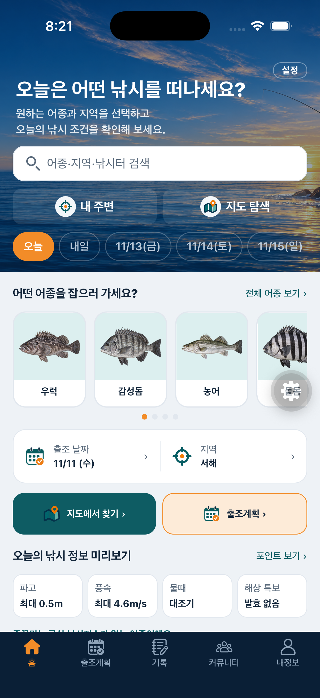
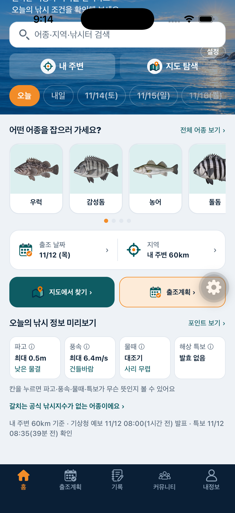
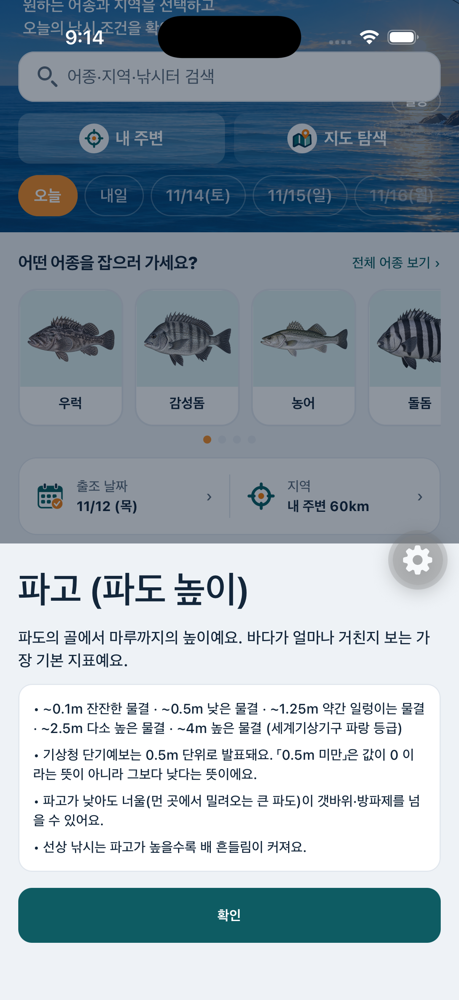
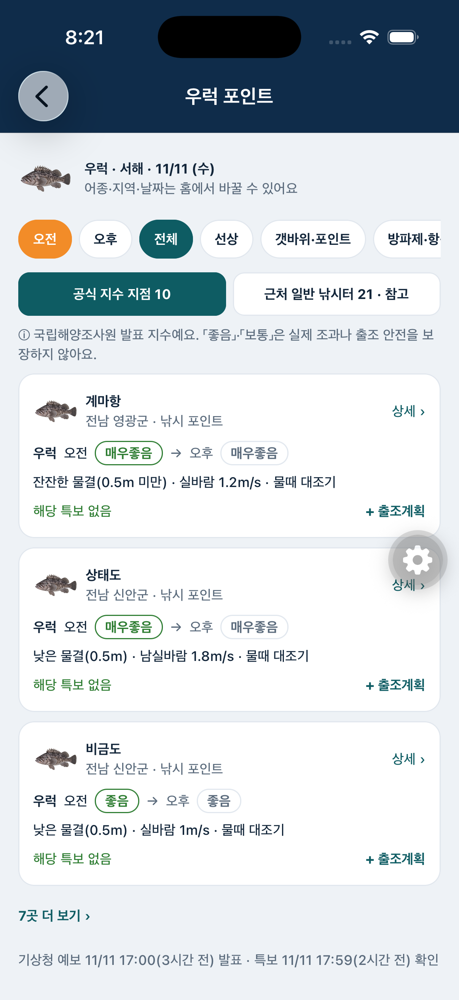
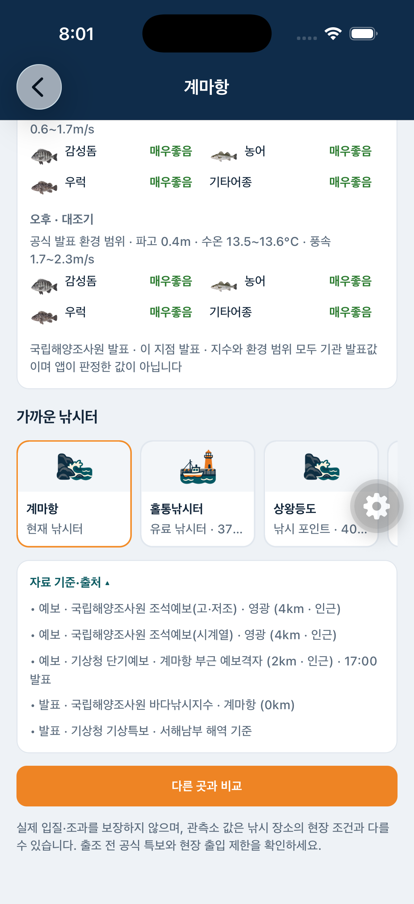
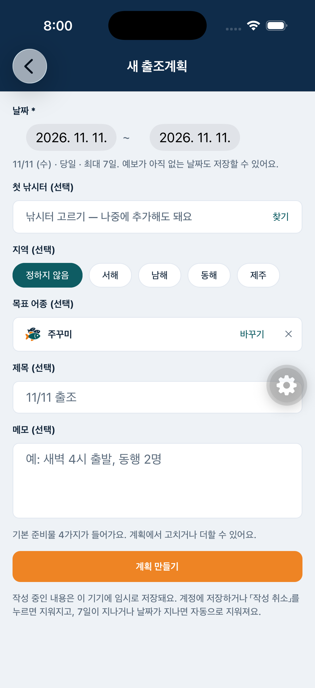
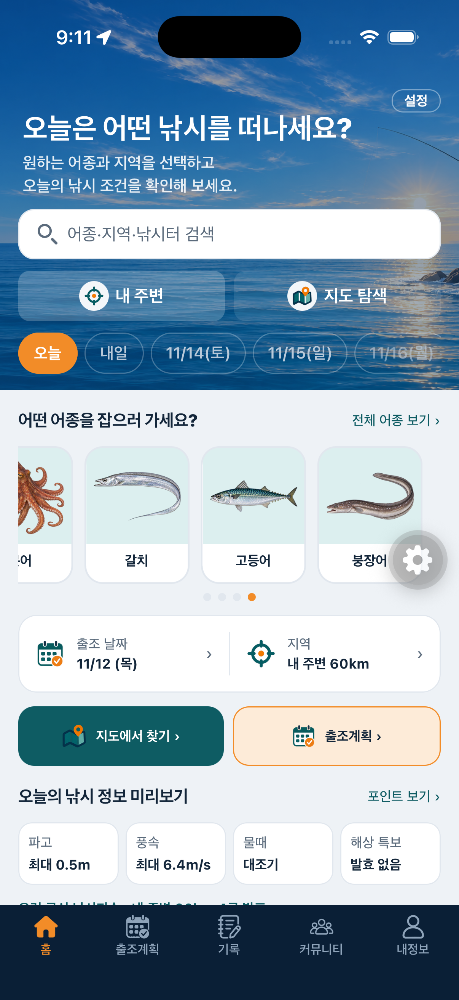
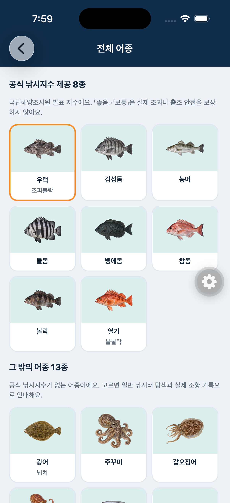
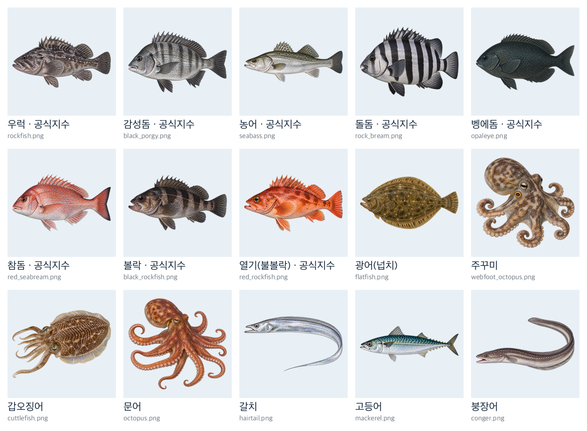
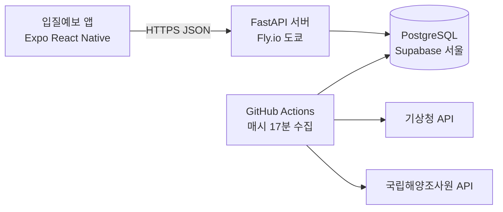

# 입질예보 발표 자료 
> 이 문서 하나로 전체를 볼 수 있게 정리했습니다. 각 항목의 「자세히」는 상세 문서로 이어집니다.

**한 줄 소개** — 공식 데이터로 오늘의 바다를 믿고 확인하고, 잡고 싶은 어종에서 출조 계획·조황 기록까지 하나로 이어지는 낚시인의 공간

---

## 1. 기획 의도

바다를 바라보며 입질을 기다리던 즐거운 기억에서 출발했다. 낚시를 좋아하는 사람들이 추억과 경험을 기록·공유할 공간을 만들고 싶었지만, 출조 준비에 필요한 물때·파고·풍속·수온·특보는 여러 사이트에 흩어져 있었다.

입질예보는 기상청·국립해양조사원 공공데이터로 출조 정보를 한곳에 모으고, 조황과 경험을 나누는 커뮤니티를 함께 제공한다. **출조를 준비하는 순간부터 돌아온 이후까지 하나로 이어지는 공간**이 목표다.

자세히 → [개발 배경 및 기획 의도](01_기획/2026-11-12_개발배경_및_외부API.md#1-개발-배경-및-기획-의도)

## 2. 차별성 — 핵심 3가지

1. **어종 중심 탐색** — 「어떤 물고기를 잡으러 가세요?」에서 시작해 공식 낚시지수 지점과 출조계획까지 바로 이어진다
2. **믿을 수 있는 공공데이터** — 기관 발표값을 출처·시각과 함께 그대로. 위치가 의심되거나 자료가 없으면 솔직하게 「확인 불가」
3. **경험을 잇는 커뮤니티** — 출조 준비 → 낚시 → 인증 조황 기록·공유가 한 앱에서

자세히(9가지 강점·구현 근거) → [차별성](01_기획/2026-11-12_개발배경_및_외부API.md#4-차별성--입질예보만의-강점)

## 3. 주요 화면 (iOS 시뮬레이터 실제 화면)

| 홈 — 어종 선택 · 날짜·지역 | 오늘의 낚시 정보 (쉬운 말) | 용어 풀이 |
|---|---|---|
|  |  |  |

| 포인트 보기 — 우럭 공식 지수 지점 | 낚시터 상세 — 공식 지수 | 출조계획 — 목표 어종 자동 입력 |
|---|---|---|
|  |  |  |

| 내 주변 (GPS) | 전체 어종 | 어종 일러스트 15종 |
|---|---|---|
|  |  |  |

- 홈 흐름: 바다 배경·검색 → **어종 카드** → [출조 날짜 | 지역] → [지도에서 찾기] [출조계획] → 오늘의 낚시 정보(파고·풍속·물때·특보)
- 공식 지수 어종은 [공식 지수 지점] / [근처 일반 낚시터 · 참고] 를 구분, 공식 지수 없는 어종은 그렇다고 안내
- 시뮬레이터의 「내 주변」은 테스트 좌표(충남 태안) 기준. 실제 아이폰은 기기 GPS 사용

자세히 → [어종 중심 홈 설계·구현 결과](05_UX/2026-11-11_어종중심_홈_설계안.md) · [iOS UI 검증 결과](05_UX/2026-11-10_iOS_UI검증_결과.md)

## 4. 공공데이터와 용어

| 기관 | 자료 | 앱에서 |
|---|---|---|
| 국립해양조사원 | 조석예보(고·저조, 시계열) | 만조·간조, 물때 그래프 |
| 국립해양조사원 | 해양관측부이 | 파고·풍속·수온 실측 |
| 국립해양조사원 | 바다낚시지수 | 어종별 공식 등급(8종·49지점, 오전·오후) |
| 기상청 | 단기예보 | 파고·풍속·기온·강수 예보 |
| 기상청 | 기상특보 현황 | 해상 특보·예비특보 |

- **공식 바다낚시지수**: 국립해양조사원이 지점·어종별로 바다 조건이 그 어종 낚시에 얼마나 맞는지 5단계로 발표. 「좋음」이 조과·안전 보장은 아님
- 파고·풍속은 세계기상기구 파랑 등급·보퍼트 풍력 등급으로 「낮은 물결」「건들바람」처럼 풀어서 보여줌

자세히 → [외부 API 전체 목록](01_기획/2026-11-12_개발배경_및_외부API.md#2-사용-중인-외부-api서비스) · [용어 풀이](01_기획/2026-11-12_개발배경_및_외부API.md#3-주요-정보와-용어-풀이) · [공공 API 검증 결과](03_데이터/공공API_검증결과.md)

## 5. 시스템 구성 (현재 운영 중)

| 구성 | 내용 |
|---|---|
| 앱 | React Native + Expo (iOS 개발 빌드), Expo Router |
| 서버 | FastAPI · `https://biteforecast-api.fly.dev/api/v1` · 요청 없으면 자동 정지 |
| DB | Supabase PostgreSQL(서울) · Alembic 구조 관리 · 외부 공개 권한 차단(RLS) |
| 수집 | GitHub Actions 매시 17분 — Mac 이 꺼져도 동작 |
| 비용 | Supabase·GitHub 무료, Fly 월 약 $2 수준 |

자세히 → [Fly 배포](03_데이터/2026-11-11_Fly_배포.md) · [Supabase 전환·성능](03_데이터/2026-11-11_Supabase_사본.md) · [API 명세](02_명세/2026-11-11_발표용_API_명세.md)

## 6. 데이터 신뢰와 품질

- **좌표 검증**: 낚시터 219곳 좌표 품질 등급(A~D)·검증 이력. 의심 좌표는 해황 연결·추천에서 제외 → [좌표 품질 검증](03_데이터/2026-11-09_좌표품질_검증보고서.md) · [주소 API 대조](03_데이터/2026-11-10_주소API_좌표대조_보고서.md)
- **특보 상태 구분**: 특보 없음 / 다른 해역에만 있음 / 적용 해역 모름 / 자료 만료 / 수집 실패를 서로 다르게 표시
- **원칙**: 자료가 없으면 0 대신 「자료 없음」, 앱 자체 조황 점수 없음, 가짜 조황 없음
- **성능**: 원격 DB 왕복을 줄여 홈 요약 60초 → 약 1초 (쿼리 4,919 → 23)

## 7. 검증

| 항목 | 결과 |
|---|---|
| 백엔드 테스트 | 111개 통과 (SQLite·PostgreSQL 양쪽) — 쿼리 수 상한 테스트 포함 |
| 앱 정적 검사 | TypeScript·ESLint 통과 |
| iOS 시뮬레이터 | 홈·어종 선택·포인트 보기·상세·출조계획·GPS·용어 풀이 화면 확인 (위 스크린샷) |
| 배포 | Fly 서버·Supabase·자동 수집 동작 확인 |

## 8. 한계와 다음 단계

- 국립해양조사원 **조류예보**: 인증키 미등록으로 보류
- **실제 아이폰** GPS·전체 흐름 검증, 작은 화면·다크 모드 확인
- **Android** 배포 시 Google 지도 키 필요
- 어종 6종(돌돔·벵에돔·열기·문어·갈치·붕장어) 어종 목록 정식 추가 여부
- 감성돔 일러스트 줄무늬 보정 검토

---

### 상세 문서 전체
- 기획: [개발 배경·외부 API·용어·차별성](01_기획/2026-11-12_개발배경_및_외부API.md) · [요구사항 요약](01_기획/2026-11-11_발표용_요구사항_요약.md) · [기능명세서](02_명세/입질예보_기능명세서.md)
- 화면: [어종 중심 홈](05_UX/2026-11-11_어종중심_홈_설계안.md) · [출조계획 설계](05_UX/2026-11-09_출조계획_설계안.md) · [iOS UI 검증](05_UX/2026-11-10_iOS_UI검증_결과.md)
- 데이터·운영: [공공 API 검증](03_데이터/공공API_검증결과.md) · [Supabase](03_데이터/2026-11-11_Supabase_사본.md) · [Fly 배포](03_데이터/2026-11-11_Fly_배포.md) · [아키텍처](06_개발환경/2026-11-11_시스템_아키텍처_및_플로우차트.md) · [실행 가이드](06_개발환경/실행_가이드.md)
